# Swift Cycle Design

## Status

- Status: active.
- Current conclusion: maintain one standards-based Skill with system-level explicit invocation and project-level persistent adoption. After one explicit adoption, the project `AGENTS.md` binds Swift Cycle so later tasks route, synchronize documentation, and close milestones automatically inside the project boundary.
- Scope: canonical workflow, document profiles, optional templates, language resolution, host compatibility, and source/deployment boundaries.
- Update trigger: revise this document when the Skill package, scenario routes, document profiles, language strategy, invocation policy, or supported host boundary changes.

## Goals

- Keep personal and small projects coherent without importing heavyweight organizational process.
- Preserve one portable workflow across Agent Skills-compatible hosts.
- Keep the canonical Skill and default prompt in Simplified Chinese while preserving bilingual product entry points and target-file language.
- Keep system-level invocation explicit, while allowing an adopted project's committed instructions to require the Skill without repeated user commands.
- Keep simple work minimal while giving complex project, runtime, and integration work a reusable document shape.
- Detect documentation drift and promote confirmed failure guards without creating a second project state machine.

## Structure

```text
skill_swift_cycle/
├─ skills/
│  └─ swift-cycle/
│     ├─ SKILL.md               # Concise Simplified Chinese canonical entry
│     ├─ agents/openai.yaml     # Codex interface and explicit-only policy
│     ├─ references/
│     │  ├─ adoption-and-routing.md # One-time adoption and background phase routing
│     │  ├─ document-information-architecture.md # Conditional docs home, responsibility groups, and index metadata
│     │  ├─ document-profiles.md # Automatic profile selection and conformance
│     │  ├─ governance-boundaries.md # Triggered governance and evidence boundaries
│     │  ├─ lifecycle-and-closeout.md # Candidate, packet, and closeout details
│     │  └─ zh-CN.md            # Concise terminology and wording guidance
│     └─ templates/             # Optional profile-aligned starting points
├─ docs/
│  └─ compatibility.md          # Host support and installation boundaries
├─ README.md                    # English user documentation
├─ README.zh-CN.md              # Simplified Chinese user documentation
├─ AGENTS.md                    # Repository maintenance rules
└─ LICENSE                      # MIT license
```

## System shape

Swift Cycle uses one explicit adoption to establish a persistent project contract, then routes later tasks through a short engineering loop:

```mermaid
flowchart LR
    Adopt[Explicit adoption] --> Binding[AGENTS persistent binding]
    Binding --> Request[Normal project request]
    Request --> Inspect[Inspect real state]
    Inspect --> Route[Detect phase and smallest profile]
    Route --> Change[Implement and synchronize]
    Change --> Verify[Verify proportionally]
    Verify --> Close[Continue or close milestone]
    Close --> Result[Result or exact blocker]
```



The diagram describes project-internal engineering. It does not assign departments, create reviewers, grant runtime authority, accept work, or operate an external registry.

## Document profiles

| Profile | Purpose | Boundary |
| --- | --- | --- |
| `minimal` | Core entry points and the shortest useful execution view | Default for small projects and bounded changes |
| `standard` | Durable architecture, roadmap, evaluation, and decisions | Add only authorities backed by long-lived facts |
| `runtime_integration` | Operations, contracts, security, storage, integration, and identity layers | Activate only when the current task establishes, changes, or verifies multiple relevant layers |

Profiles are internal starting configurations, not user-visible modes. Each adoption, material structural change, and milestone closeout records `profile_conformance`: every responsibility is mapped to reuse existing, create, or not applicable, together with one authority, reason, and update trigger. Templates are conditional structures and are never copied as a mandatory tree.

`DESIGN.md` remains the concise architecture entry. Small projects may keep their complete necessary document index there; projects whose volume, audiences, or flat layout impair discovery may add `docs/README.md` as the broader docs home. Responsibility directories are created only for actual document groups, while tutorial/how-to/reference/explanation remain purpose and audience metadata rather than a parallel hierarchy.

## Key boundaries

| Concern | Swift Cycle owns | Outside this Skill |
| --- | --- | --- |
| Project loop | One-time adoption, background phase/profile routing, finite work package, implementation, synchronization, verification, learning | Portfolio routing, capacity, model assignment, external queues |
| Documentation | Responsibility, freshness, knowledge promotion, packet freeze and retirement | Organizational registry or acceptance ledger |
| Delivery layers | Independent source, artifact, runtime, and consumer evidence | Publishing, deployment, or consumer switching without separate authority |
| Output | Project work package, Review Packet, Closeout Packet | Acceptance, activation, release, or cross-project authorization decisions |

- Words in the project, repository, and root-directory names are separated with `_`; letter case follows the chosen project name. The standards-defined Skill identifier remains `swift-cycle` because underscores are not valid in Agent Skill names.
- `SKILL.md` is a short Simplified Chinese canonical entry that contains only shared constraints, adoption detection, background routing, closure behavior, verification, and links to conditional references.
- `agents/openai.yaml` contains Codex-specific interface metadata and disables implicit invocation for Codex.
- Other hosts use the same standard Skill package and their own installation conventions.
- System-level invocation remains explicit-only. A user explicitly adopts Swift Cycle once; the project's committed `AGENTS.md` then requires the Skill for later project tasks. One-off reviews do not create persistent adoption.
- Detailed phase routing is internal. Adoption, ordinary progress, material structural change, and milestone closeout select the smallest useful route without user-facing modes or subcommands.
- Document profiles are progressive. `minimal` remains the default, while `standard` and `runtime_integration` activate only for durable facts and delivery layers that exist. `profile_conformance` makes reuse, creation, omission, authority, reason, and update triggers reviewable without creating a fixed schema file.
- Document information architecture is evidence-triggered rather than count-driven. DESIGN, a conditional docs home, and any subdirectory indexes contain links and short summaries; the durable fact remains in one shared authority. Document moves and link repairs form a bounded documentation-hygiene package, while tracked deletion or a change of authority still requires its own authorization.
- Optional templates encode one-H1 structure, stable H2 sections, native Mermaid, concise tables, unresolved items, update triggers, and revision records. They do not impose a prose language or mandatory directory tree.
- Knowledge promotion keeps short-lived capture local and moves durable commitments, decisions, constraints, and reusable evidence into responsibility-appropriate shared assets. After promotion, the shared asset is authoritative and the local record retains only a concise pointer.
- State separation identifies labels that combine independent lifecycle questions and splits only the concerns a project actually tracks. It defines no mandatory fields or status schema, and any overall status remains a derived summary.
- Governance baselines activate only for non-trivial work that crosses authority
  boundaries, changes source/runtime relationships, or needs reliable
  before/after comparison. A baseline separates observed and target state, uses
  no mandatory file or schema, and becomes shared evidence only when later work
  depends on it.
- Commit-boundary planning activates for multiple commits, mixed-purpose hunks,
  ordered dependencies, or independently reviewable history. Prefer one atomic
  commit when a split cannot preserve a coherent intermediate state.
- Source, artifact, runtime, and consumer state are optional independent layers.
  Evidence and authorization do not transfer between them, and projects track
  only the layers they actually have.
- Transition checks use canonical contracts and independently evidenced identities. Git source mode is not an installed permission, and tests must not share one incorrect derived authority with the manifest they claim to verify.
- Local `TODO.md` is the current execution view, not the durable source for
  cross-machine plans. Durable plans belong in a committable feasibility
  report, roadmap, or shared issue tracker.
- A normal TODO checklist remains the default. The Agent activates milestone
  structure only when the task actually has multiple stages or commits; the
  user does not choose a mode.
- Swift Cycle defines this portable PR-sized increment contract directly. It
  does not depend on Superpowers or reproduce plugin-specific mechanisms.
- Work may continue through listed, reversible steps under one unchanged authority without repeating internal approval prompts. Ordinary documentation, Mermaid, table, TODO, and DEVLOG maintenance are normal in-package steps. Materially new authority, substantive goal or architecture change, an ambiguous authority location, contradictory evidence, external side effects, or unsafe rollback stop the loop.
- Milestone closeout automatically reconciles affected README, DESIGN, docs, TODO, DEVLOG, and active packets, or records why there is no documentation impact.
- Documentation freshness is event-driven. Milestone, decision, contract, runtime, or consumer changes trigger a focused reconciliation of status, pending work, unknowns, identities, indexes, and packets.
- Review Packets are dated or milestone-bound frozen snapshots. Closeout Packets summarize project evidence for an external loop; neither creates organizational acceptance, activation, release, or a second state machine.
- Confirmed reusable failures follow failure mode, cause, corrective assertion, and reusable gate. Unconfirmed one-off failures remain local.
- Repository maintenance details do not belong in the Skill package.
- Host-installed Skill copies and installer-added source metadata are deployment
  artifacts, not repository source. Moving or renaming this checkout does not
  authorize reinstalling, updating, or relinking an installed copy.
- No scripts, runtime dependencies, MCP servers, or external services are required.

## Language strategy

- Conversation and final-report language use the user's explicit request, then the current invocation language.
- Existing-file language uses the user's explicit request, the file's established primary language, the project language, then the invocation language.
- New-file language uses the user's explicit request, the project language, then the invocation language.
- A conversation-language change does not authorize bulk translation. Bilingual counterparts exist only when the project already maintains them or the user requests them.
- Preserve filenames, commands, APIs, code identifiers, standard status values, and repository terminology. Avoid accidental mixed-language prose.
- The canonical Skill body and Codex default prompt are maintained in Simplified Chinese. English README content remains an auxiliary product entry point, while target project documents preserve their established language.

## Compatibility strategy

- Follow the open Agent Skills directory and `SKILL.md` format.
- Validate the package with both the OpenAI Skill validator and `gh skill publish --dry-run`.
- Keep strict explicit-only behavior in Codex metadata.
- Document host-specific manual-invocation controls instead of adding non-standard fields to the canonical frontmatter.

## Unresolved items

- No script is currently required. Mechanical checks remain a candidate only if stable structure or freshness failures cannot be caught reliably with existing validators and focused review.
- Installed Skill copies remain separately versioned deployment state and are not updated by source edits.

## Revision record

| Date | Change |
| --- | --- |
| 2026-08-31 | Added conditional document information architecture: concise DESIGN entry, optional docs home, responsibility-based grouping, Diátaxis index metadata, and bounded documentation-hygiene work. |
| 2026-08-31 | Switched to a concise Simplified Chinese canonical entry, one-time explicit adoption with persistent project binding, background routing, automatic milestone documentation closeout, and profile conformance. |
| 2026-08-30 | Added project-internal scenario routing, progressive document profiles, language resolution, freshness and packet lifecycle, proportional verification, and reusable learning boundaries. |
