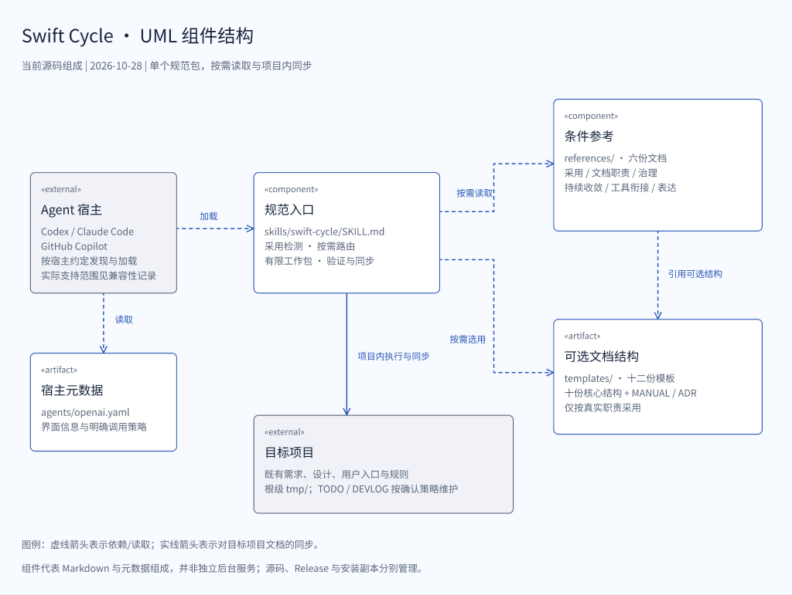

# Swift Cycle 概要设计

> 状态：持续维护；本页按当前源码整理，不代表新 Release 或安装更新。
> 最近更新：2026-10-28
> 需求依据：[已确认工程规约](docs/engineering_standard.md)；项目意图复用[中文用户入口](README.zh-CN.md#features)，英文入口同步表达。

<a id="swift-cycle-design"></a>
<a id="status"></a>
<a id="goals"></a>
<a id="swift-cycle-设计"></a>
<a id="状态"></a>
<a id="目标"></a>

## 设计概要

**设计目标：**用一个可移植的文档型 Agent Skill，支撑单项目的采用、需求调整、有限工作包、验证、文档同步和经验沉淀。小任务保持简短，复杂事实才增加独立说明。

**总体方案：**规范入口 SKILL.md 保留共同约束与后台路由；六份参考按任务提供细则；十二份模板作为可选起点；宿主元数据只承载 Codex 界面及调用策略。实际执行由 Agent 宿主完成，包内没有脚本、服务或运行依赖。

**设计范围：**单项目工程循环、意图与确认需求分离、逐包收敛、语言与图示交付、按需工具衔接，以及源码/安装/运行证据边界。不负责组织路由、容量管理、独立验收、Registry 或跨项目运行授权。

当前模板与参考以 25a9c0d 合入 main，本仓库文档自用以 3784966 交付。此基线通过新 Agent 的三个有界场景，已发布固定 v1.5.0 并将本机现有 Skill 更新到同一固定包；v1.4.0 与 2026-10-19 本地安装记录保持历史性质。发布与本机安装分别核对，见[本轮验收与交付](docs/compatibility.md#release-v1-5-0-and-local-installation-2026-10-28)。


## 整体结构与模块职责

### UML 结构图



[可编辑 Figma 原稿](https://www.figma.com/design/pnJ9uf3FwITsv4ElFYMwTN?node-id=3-2) · [SVG 导出](docs/images/swift_cycle_components.svg)

图中组件是 Markdown 与元数据组成，不是独立后台服务。虚线箭头表示读取/依赖，实线表示项目内文档同步；外部宿主和目标项目不属于可安装包。

### 模块职责

| 组成 | 负责什么 | 依赖与实现位置 |
| --- | --- | --- |
| 规范入口 | 明确调用边界、采用检测、最小路由、有限工作包和验证原则 | [SKILL.md](skills/swift-cycle/SKILL.md)，按需链接参考 |
| 条件参考 | 分别维护采用、文档职责、治理、同步收口、可选工具及表达细则 | [references/](skills/swift-cycle/references/)；完整规则各有唯一位置 |
| 可选模板 | 十份核心结构与可选 MANUAL、ADR，不自动生成全树 | [templates/](skills/swift-cycle/templates/)，由文档职责选择 |
| 宿主元数据 | Codex 显示信息、默认提示词及关闭系统层隐式调用 | [agents/openai.yaml](skills/swift-cycle/agents/openai.yaml) |
| 维护仓库 | 用户入口、概要设计、工程规约、兼容证据和本地行动 | 本页、双语 README、[AGENTS](AGENTS.md)及 docs/；不全量装入 Skill |

新增能力、职责/依赖变化或重构时，先有界检索已有实现、调用者与测试，说明复用/扩展/新建理由；重构用相关回归保留行为。导航只维护受影响能力，不建第二份能力台账。

<a id="system-shape"></a>
<a id="language-strategy"></a>
<a id="系统形态"></a>
<a id="语言策略"></a>

## 核心功能与实现概览

| 功能 | 已确认要求 | 实现方式与入口 |
| --- | --- | --- |
| 一次采用、持久使用 | 系统层明确调用；项目采用须获用户同意 | 由项目 AGENTS 建立绑定，后续按仓库指令读取 Skill；[采用与路由](skills/swift-cycle/references/adoption-and-routing.md) |
| 意图与需求分开 | BLUEPRINT 构想不自动成为实施承诺 | 复用完整现有意图来源，确认行为归 PRD 或等价依据；新项目默认 docs/BLUEPRINT.md |
| 初始化与本地记录 | 获准创建/正式初始化须有效交付根级 TODO/DEVLOG | 只补缺失项，保留有效记录；Git/非 Git、占位、权限和策略冲突分别判断；[初始化预检](skills/swift-cycle/references/document-profiles.md#本地记录与初始化预检) |
| 临时材料集中 | 可写任务必须有根级 tmp/；只读不创建 | Git 精确忽略 /tmp/，可控输出仅按工具/子进程重定向；保留已有内容，不改全局环境或授予清理权限 |
| 项目进度与经验 | 进度、里程碑、问题及后续可发现 | TODO 在开始、实质进展、问题/阻塞变化及完成时同步；DEVLOG 用紧凑条目留有效经验，不批量接收旧 TODO |
| 每包收敛 | 结果、验证和说明同时完成 | 先确认需求影响，再同步相关用户说明、设计与安排；[持续收敛](skills/swift-cycle/references/lifecycle-and-closeout.md) |
| 语言与展示 | 会话语言和文件语言分别解析 | 文件优先用户明确要求，再用既有主语言/项目语言；保留精确技术标识。README 用 Emoji 导航，其余模板不继承此风格 |
| 图示与工具 | 图示按语义、实际关系和可用权限交付 | 架构 UML 使用 Figma 原稿及 PNG/SVG；其他时序/状态/流程按需用 Mermaid 等；[表达与图示](skills/swift-cycle/references/zh-CN.md#工程图) |

### 工程循环


阶段判断只在后台进行，不增加模式菜单、子命令或固定状态 Schema。目标与授权不变时继续普通可逆步骤；新实质授权、目标/架构变化、唯一依据不明、证据冲突或无法安全恢复时停止并请求决定。

复杂阶段才使用 docs/milestones/M{N}_PLAN.md，一阶段一份现行正式计划，TODO 摘要链接；阶段是否完成需另核总体退出条件。可选 Superpowers 衔接保留解析边界，不由辅助器测试推导完整插件兼容。


## 接口与数据概览

本项目没有 HTTP API、数据库或独立运行服务。主要接口是可移植 Skill 目录、Markdown 链接及宿主的加载/安装约定。

| 交互 | 输入 → 输出 | 归属与边界 |
| --- | --- | --- |
| 宿主加载 | 明确 Skill 选择/项目绑定 → 规范入口及条件参考 | 调用方式依宿主；Codex 元数据保持 allow_implicit_invocation=false |
| 项目维护 | 用户目标、既有文件与真实状态 → 最小修改、验证和相应说明 | 权限来自当前任务，不来自模板、TODO 或 Skill 本身 |
| 模板采用 | 已确认职责与文件语言 → 真实项目内容 | 不保留教学占位，不复制已有完整等价正文 |
| 安装器 | 固定来源或本地源码 → 独立安装副本及来源元数据 | 元数据属于部署状态，不能写回规范源码 |
| 证据交付 | 直接观察与相关检查 → 有边界的结论/必要摘要 | 审查快照交付后冻结；源码、产物、运行和消费者证据不跨层转移 |

规范包随仓库受 Git 跟踪；本仓库 TODO.md、DEVLOG.md 和 tmp/ 按现有策略忽略。消费者项目是否跟踪记录沿用其已确认策略。可复用长期事实回写对应共享正文，本地只保留经验或链接；Git 历史不替代忽略记录、用户数据或恢复点。

<a id="structure"></a>
<a id="目录结构"></a>

## 代码与目录组织

```text
skill_swift_cycle/
├── AGENTS.md                         # 本仓库执行规则与源码自用绑定
├── DESIGN.md                         # 概要设计、UML 与详细文档导读
├── DEVLOG.md                         # 本地维护经验；忽略
├── LICENSE                           # MIT 许可证
├── README.md                         # 英文用户入口
├── README.zh-CN.md                   # 简体中文用户入口及既有项目意图
├── TODO.md                           # 本地进度、问题与后续；忽略
├── docs/
│   ├── compatibility.md              # 分日期、层次的兼容与交付证据
│   ├── engineering_standard.md       # 已确认源码规范与模板栏目依据
│   └── images/
│       ├── swift_cycle_components.png # 组件图预览
│       └── swift_cycle_components.svg # Figma 组件图导出
├── skills/
│   └── swift-cycle/                  # 唯一规范安装包
│       ├── SKILL.md                  # 简短共享入口
│       ├── agents/openai.yaml        # Codex 元数据与明确调用策略
│       ├── references/
│       │   ├── adoption-and-routing.md # 采用与后台路由
│       │   ├── document-profiles.md  # 职责、模板、命名、复用与回收
│       │   ├── governance-boundaries.md # 治理与独立证据
│       │   ├── lifecycle-and-closeout.md # 同步、收口与退役
│       │   ├── superpowers-bridge.md # 可选工具衔接
│       │   └── zh-CN.md             # 表达、图示与用户交付
│       └── templates/               # 按真实职责采用的十二份模板
│           ├── AGENTS.md / DESIGN.md / DEVLOG.md / README.md / TODO.md
│           └── docs/
│               ├── BLUEPRINT.md / MANUAL.md / PRD.md / ROADMAP.md / SAD.md
│               ├── adr/ADR-NNN.md   # 独立决策候选提纲
│               └── milestones/M1_PLAN.md # 稳定编号实施计划
└── tmp/                              # 可写任务临时工作区；忽略
```

代码树展示主要实际路径，合并行仅为排版，不改变实体布局。新普通 docs 路径使用小写 snake_case，固定专业文档名和稳定 M 编号计划按规约保留例外；已有完整等价来源不自动改名。

规范入口只链接条件参考；文档职责与格式的唯一规则在 document-profiles，同步时机在 lifecycle-and-closeout，图示操作在 zh-CN。查找能力时沿入口 → 对应参考 → 模板/既有证据定位，不按文件数量扩树。

<a id="document-profiles"></a>
<a id="key-boundaries"></a>
<a id="compatibility-strategy"></a>
<a id="关键边界"></a>
<a id="兼容性策略"></a>

## 交付与运行形态

| 对象 | 当前形态 |
| --- | --- |
| 可安装产物 | skills/swift-cycle/ 的二十个规范文件；包内无脚本、依赖或厂商复制版本 |
| 执行位置 | 支持 Agent Skills 的宿主；具体安装路径和调用方式见兼容说明 |
| 安装副本 | 独立真实目录；固定 Release、本地路径及源码 HEAD 各自保留身份，不由源码编辑自动更新 |
| 外部工具 | 架构图按条件需要 Figma；Superpowers 为可选衔接，工具可用性及权限不预设 |
| 仓库材料 | 双语入口、设计、规约、图示和历史兼容证据不随整个仓库全量安装 |

### 文档档位

| 档位 | 增加什么 | 使用条件 |
| --- | --- | --- |
| minimal | 项目意图、核心入口与最短有效执行视图 | 小项目与有界修改默认使用 |
| standard | 独立维护的详细架构、ROADMAP 与决策 | 确有长期事实，不由跨会话或多提交触发 |
| runtime_integration | 操作、合同、安全、存储、集成和身份层 | 当前任务真实涉及多个相关层次 |

档位不构成必建目录树或合规台账。本仓库复用既有 README 和源规约，不为自用增加空 BLUEPRINT、PRD、ROADMAP、MANUAL 或重复计划。

### 职责与授权边界

| 事项 | Swift Cycle 负责 | 范围之外 |
| --- | --- | --- |
| 项目循环 | 采用、路由、工作包、实施、同步、验证和经验 | 跨项目统筹、容量、模型分配、外部队列 |
| 项目意图 | 受跟踪 BLUEPRINT 或映射等价来源及重大变化更新 | 代替用户决定、运行态、Registry 或验收 |
| 文档 | 唯一正文、新鲜度、知识沉淀、快照冻结与退役 | 组织注册表、验收台账或第二状态机 |
| 交付层次 | 分别举证源码、产物、运行与消费者状态 | 未获授权的发布、安装、部署或消费者切换 |

治理基线、多提交规划与状态拆分只在实际风险触发时采用，不强制文件或字段。Git 文件模式不证明安装权限；身份检查不能与待测清单共用错误推导值。文档整理不授予资产删除或自动清空 tmp/ 的权限。

<a id="unresolved-items"></a>
<a id="revision-record"></a>
<a id="待定事项"></a>
<a id="修订记录"></a>

## 设计文档导读

| 文档 | 回答什么问题 | 何时阅读 |
| --- | --- | --- |
| [中文入口](README.zh-CN.md) / [英文入口](README.md) | 用途、准备、安装、首次使用与求助 | 初次使用或用户可见行为变化 |
| [仓库执行规则](AGENTS.md) | 当前维护、语言、权限与验证要求 | 修改本仓库前 |
| [工程规约](docs/engineering_standard.md) | 已确认工程要求、十核心模板栏目及图示条件 | 变更 Skill 或模板 |
| [文档职责](skills/swift-cycle/references/document-profiles.md) | 文档选择、命名、初始化、复用与回收 | 创建/整理文档或结构变化 |
| [持续收敛](skills/swift-cycle/references/lifecycle-and-closeout.md) | 新需求、每包同步和阶段退出 | 项目推进或整理记录 |
| [兼容与交付证据](docs/compatibility.md) | 哪个来源、日期及层次真正验证过 | 安装、交付或核对支持声明 |
| [可选工具衔接](skills/swift-cycle/references/superpowers-bridge.md) | 编号计划和辅助器边界 | 项目实际选择 Superpowers 时 |

当前必要概要由本页承载，无需为自用新增空 SAD 或 ADR。机械校验仅在既有校验与针对性审查不足时考虑；本地校验结果不替代实际 Agent、宿主或长期行为。图示源稿和导出本次已经交付，其他宿主、完整辅助流程等仍按兼容记录分别标明未验证。

### 既有修订记录

以下保留原记录形成时的结论；“未提交/未发布/未安装”等仅指对应历史时点，当前状态以本页开头和兼容记录为准。

<details>
<summary>展开既有修订记录</summary>

| 日期 | 变更 |
| --- | --- |
| 2026-10-28 | 按用户要求退役本地旧 Superpowers 工作目录及已跟踪的历史 README 设计记录；当前检查只使用可用工具与必要 tmp 工作。此前参考修订和可移植包保持，不重建替代历史树，不更新安装副本。 |
| 2026-10-28 | 通过内容分组、同步矩阵、简明术语和明确图示条件改善六份参考的可读性；保留文件名、文档档位章节/表格、初始化/tmp/回收保护及全部模板。未暂存、Git 交付或安装。 |
| 2026-10-28 | 退役文档首页与 ADR 索引模板，移除活动模板路由，将必要导航和 ADR 采用/命名指引归入 document-profiles.md。十份核心模板和独立 ADR 决策提纲保留，不新增替代索引模板，不更新安装副本。 |
| 2026-10-28 | 可写任务强制使用根级 tmp/，同步采用/绑定与模板指引，临时路径重定向限于工具/进程范围。保留只读、记录、跟踪、回收和安装边界。 |
| 2026-10-28 | 在条件表、Skill/参考指引、模板、双语入口和源规约之间同步当前文档标识与职责描述；澄清 DESIGN/SAD/MANUAL 导航，增加提纲直接比对和表序回归。未更新安装副本或 Git 交付。 |
| 2026-10-28 | 退役两份可选审查/收口模板及其活动链接/路由；保留按需证据、快照冻结和授权边界，不新增替代模板。历史记录、其他模板和安装分别保持。 |
| 2026-10-28 | 恢复 docs/BLUEPRINT.md 为项目蓝图默认路径和模板标题，同步活动命名/引用与表序；此前 VISION 命名记录作为历史保留。Packet 模板当时仅检查，仍可选且未改动。 |
| 2026-10-28 | 批准源码命名：docs/VISION.md、PRD.md、SAD.md、ROADMAP.md、可选 MANUAL.md，以及稳定 M1_PLAN.md 式计划；保留独立 ADR，退役独立 evaluation 模板/创建路由。此前源码工作保持，未迁移消费者、安装或 Git 交付。 |
| 2026-10-28 | 仅源码合并为六章 document-profiles.md；保留初始化、命名、复用/重构和回收规则，退役原文档组织参考并修复路由/锚点。模板与安装未变。 |
| 2026-10-28 | 仅源码更新批准的七节 DESIGN 概要模板，新建/获准重构时必需 UML 结构图；同步规则/检查，保留此前模板，未安装或 Git 交付。 |
| 2026-10-28 | 仅源码配套更新 TODO 进度/里程碑模板与 DEVLOG 紧凑条目，可选按里程碑分组；同步事件驱动维护规则及检查。既有初始化门槛保留，未安装或 Git 交付。 |
| 2026-10-28 | 仅源码更新批准的 README 展示模板：Emoji 标题、显式导航、表格/示例、条件性资产及末尾 Star History；同步模板规则与本地检查。未更新安装副本或发布，TODO 重设计仍是单独提议。 |
| 2026-10-18 | 仅源码实施批准的增量：有效根级 TODO/DEVLOG 作为初始化完成门槛，保留已有记录，明确非 Git 与非初始化路由，有界复用/依赖/能力导航和保留行为的重构检查。验证层次分别跟踪，未安装或发布。 |
| 2026-10-13 | 实施批准的 r29 职责和十份核心模板；分离已确认需求与愿景，引入逐包收敛、Figma 架构条件和窄范围可选辅助集成。D60 部门负责人本地源码验收通过；发布与安装各有独立交付证据，真实采用仍未验证。 |
| 2026-08-31 | 澄清普通内容语言解析，以及按语义选图、审查和不预设拓扑的边界。 |
| 2026-08-31 | 增加可移植项目蓝图基线，新项目默认`docs/blueprint.md`，已有项目复用依据，明确意图生命周期边界，并统一 docs 路径小写 snake_case 命名。 |
| 2026-08-31 | 根据获准参考的项目实践增加可移植 TODO、DEVLOG、DESIGN 模板契约，限定当前工作历史、采用面向证据的维护条目，明确本地记录边界。 |
| 2026-08-31 | 增加按条件采用的文档信息架构：简明 DESIGN 入口、可选文档首页、按职责分组、Diátaxis 索引元数据和有界文档整理工作。 |
| 2026-08-31 | 切换为精简的简体中文规范入口，通过一次明确采用持久绑定项目，后台路由，自动收口里程碑文档，并按档位核对。 |
| 2026-08-30 | 增加项目内部场景路由、渐进文档档位、语言解析、新鲜度与 Packet 生命周期、适度验证和可复用经验边界。 |

</details>
