# Swift Cycle Design

## Status

- Status: active.
- Current conclusion: maintain one standards-based Skill with system-level explicit invocation and project-level persistent adoption. After one explicit adoption, the project `AGENTS.md` binds Swift Cycle so later tasks route, synchronize documentation, and close milestones automatically inside the project boundary.
- Scope: one-project workflow, vision versus confirmed requirements, conditional fixed templates, per-package convergence, language and visual delivery, optional helper integration, and source/deployment boundaries.
- Current source revision: r29 passed historical D60 local-source acceptance; the separately approved 2026-10-18 initialization/structure increment is source-only and does not inherit that acceptance. See the [source standard](docs/engineering_standard.md) and [current validation](docs/compatibility.md#source-only-initialization-and-structure-revision-2026-10-18). Release and installed v1.4.0 remain separate in [delivery status](docs/compatibility.md#fixed-version-delivery). Real project adoption, actual Figma drawing/export and full Superpowers execution remain unverified.
- Update trigger: revise this document when the Skill package, scenario routes, document profiles, language strategy, invocation policy, or supported host boundary changes.

## Goals

- Keep personal and small projects coherent without importing heavyweight organizational process.
- Preserve one portable workflow across Agent Skills-compatible hosts.
- Keep the canonical Skill and default prompt in Simplified Chinese while preserving bilingual product entry points and target-file language.
- Keep system-level invocation explicit, while allowing an adopted project's committed instructions to require the Skill without repeated user commands.
- Keep simple work minimal while giving complex project, runtime, and integration work a reusable document shape.
- Give every new project one tracked intent baseline before substantive implementation while reusing complete brownfield authorities without duplication.
- Detect documentation drift and promote confirmed failure guards without creating a second project state machine.

## Structure

```text
skill_swift_cycle/
├─ skills/
│  └─ swift-cycle/
│     ├─ SKILL.md               # Concise Simplified Chinese canonical entry
│     ├─ agents/openai.yaml     # Codex interface and explicit-only policy
│     ├─ references/
│     │  ├─ adoption-and-routing.md # One-time adoption and background phase routing
│     │  ├─ document-information-architecture.md # Conditional docs home, responsibility groups, and index metadata
│     │  ├─ document-profiles.md # Automatic profile selection and conformance
│     │  ├─ governance-boundaries.md # Triggered governance and evidence boundaries
│     │  ├─ lifecycle-and-closeout.md # Candidate, packet, and closeout details
│     │  ├─ superpowers-bridge.md # Optional, tested helper boundary
│     │  └─ zh-CN.md            # Concise terminology and wording guidance
│     └─ templates/             # Optional profile-aligned starting points
│        ├─ README.md / AGENTS.md
│        ├─ BLUEPRINT.md        # Renders to docs/blueprint.md
│        ├─ docs/               # Requirements, architecture, roadmap, numbered plan and optional references
│        ├─ DESIGN.md
│        ├─ DEVLOG.md
│        └─ TODO.md
├─ docs/
│  ├─ engineering_standard.md  # Approved source spec, outside the installable package
│  └─ compatibility.md          # Host support and installation boundaries
├─ README.md                    # English user documentation
├─ README.zh-CN.md              # Simplified Chinese user documentation
├─ AGENTS.md                    # Repository maintenance rules
└─ LICENSE                      # MIT license
```

## System shape

Swift Cycle uses one explicit adoption to establish a persistent project contract, then routes later tasks through a short engineering loop:

```mermaid
flowchart LR
    Adopt[Explicit adoption] --> Binding[AGENTS persistent binding]
    Binding --> Request[Normal project request]
    Request --> Inspect[Inspect real state]
    Inspect --> Route[Detect phase and smallest profile]
    Route --> Change[Implement and synchronize]
    Change --> Verify[Verify proportionally]
    Verify --> Close[Continue or close milestone]
    Close --> Result[Result or exact blocker]
```



The diagram describes project-internal engineering. It does not assign departments, create reviewers, grant runtime authority, accept work, or operate an external registry.

## Document profiles

| Profile | Purpose | Boundary |
| --- | --- | --- |
| `minimal` | Project intent, core entry points, and the shortest useful execution view | Default for small projects and bounded changes |
| `standard` | Durable architecture, roadmap, evaluation, and decisions | Add only authorities backed by long-lived facts |
| `runtime_integration` | Operations, contracts, security, storage, integration, and identity layers | Activate only when the current task establishes, changes, or verifies multiple relevant layers |

Profiles are internal starting points, not required conformance ledgers or directory trees. Reuse existing complete authorities, adding only responsibilities the project actually needs.

Authorized project creation or formal initialization requires valid root TODO.md and DEVLOG.md even in `minimal` and non-Git projects. The main Skill states the completion gate; document-profiles owns creation, preservation, ignore-policy and conflict details; adoption-and-routing owns completion readback. Existing valid records remain byte-preserved, only missing files are added, and mere adoption/read-only/ordinary maintenance does not trigger initialization.

Important capability, responsibility/dependency changes or refactors activate bounded structural checks in document-information-architecture: search existing implementations/callers/tests, justify reuse/extension/new placement, state ownership and allowed dependencies, and link the affected capability to implementation, entry, tests and existing evidence. Refactors preserve specified behavior through relevant regressions, without a parallel capability ledger or automatic cleanup. The AGENTS/DESIGN templates carry only entry conditions and the affected navigation, not a second workflow.

Blueprint describes vision, users and product boundaries. Effective confirmed requirements live in `docs/requirements.md` or an equivalent source; design and stage arrangements follow selected requirements, not every Blueprint idea. New requirements are assessed and scheduled prospectively, while original completed-stage scope remains accurate.

The ten core templates preserve approved Chinese H2 sequences for new or authorized whole-document restructuring. Small edits do not initialize the tree. Professional outlines remain candidates. DESIGN explains the solution and when/how to read detailed documents; it is not just a fixed metadata index.

Architecture diagrams use editable Figma sources plus repository PNG/SVG exports and an original-source entry. Layout follows real relationships and user aesthetics, without mandatory containers. Workflow, sequence, state and dependency diagrams may still use Mermaid or established tools. Figma unavailability means the required diagram is unfinished, not silently substituted.

Numbered milestone plans are the sole formal execution plans when complexity warrants them; local TODO points to the current package, DEVLOG retains useful lessons only. Every package verifies and synchronizes affected content, removes clear duplicates and lightly checks associated entries. There is no bulk migration of old TODO history into DEVLOG.

## Key boundaries

| Concern | Swift Cycle owns | Outside this Skill |
| --- | --- | --- |
| Project loop | One-time adoption, background phase/profile routing, finite work package, implementation, synchronization, verification, learning | Portfolio routing, capacity, model assignment, external queues |
| Project intent | One tracked Blueprint or mapped brownfield equivalent, material-change updates, and explicit supersession | User instructions, architecture, current work, history, detailed scheduling, runtime state, Registry, or acceptance |
| Documentation | Responsibility, freshness, knowledge promotion, packet freeze and retirement | Organizational registry or acceptance ledger |
| Delivery layers | Independent source, artifact, runtime, and consumer evidence | Publishing, deployment, or consumer switching without separate authority |
| Output | Project work package, Review Packet, Closeout Packet | Acceptance, activation, release, or cross-project authorization decisions |

- Words in the project, repository, and root-directory names are separated with `_`; letter case follows the chosen project name. The standards-defined Skill identifier remains `swift-cycle` because underscores are not valid in Agent Skill names.
- `SKILL.md` is a short Simplified Chinese canonical entry that contains only shared constraints, adoption detection, background routing, closure behavior, verification, and links to conditional references.
- `agents/openai.yaml` contains Codex-specific interface metadata and disables implicit invocation for Codex.
- Other hosts use the same standard Skill package and their own installation conventions.
- System-level invocation remains explicit-only. A user explicitly adopts Swift Cycle once; the project's committed `AGENTS.md` then requires the Skill for later project tasks. One-off reviews do not create persistent adoption.
- Detailed phase routing is internal. Adoption, ordinary progress, material structural change, and milestone closeout select the smallest useful route without user-facing modes or subcommands.
- Document profiles are progressive; no mandatory conformance table, fixed schema, per-package report or automatic full-tree initialization is introduced.
- Document information architecture is evidence-triggered rather than count-driven. DESIGN, a conditional docs home, and any subdirectory indexes contain links and short summaries; the durable fact remains in one shared authority. Document moves and link repairs form a bounded documentation-hygiene package, while tracked deletion or a change of authority still requires its own authorization.
- Core templates have one H1 and fixed H2 responsibilities; required content can be brief, conditional content appears only when applicable, and unknown is not not-applicable. No mandatory revision ledger is added. Exact technical identifiers are preserved; existing prose languages and bilingual entry points remain valid.
- New docs paths follow lowercase `snake_case`, with root entry points and docs index `README.md` files as documented exceptions. Existing drift is migrated only through an approved documentation-hygiene work package; the canonical rules and examples live in `document-information-architecture.md`.
- Knowledge promotion keeps short-lived capture local and moves durable commitments, decisions, constraints, and reusable evidence into responsibility-appropriate shared assets. After promotion, the shared asset is authoritative and the local record retains only a concise pointer.
- State separation identifies labels that combine independent lifecycle questions and splits only the concerns a project actually tracks. It defines no mandatory fields or status schema, and any overall status remains a derived summary.
- Governance baselines activate only for non-trivial work that crosses authority
  boundaries, changes source/runtime relationships, or needs reliable
  before/after comparison. A baseline separates observed and target state, uses
  no mandatory file or schema, and becomes shared evidence only when later work
  depends on it.
- Commit-boundary planning activates for multiple commits, mixed-purpose hunks,
  ordered dependencies, or independently reviewable history. Prefer one atomic
  commit when a split cannot preserve a coherent intermediate state.
- Source, artifact, runtime, and consumer state are optional independent layers.
  Evidence and authorization do not transfer between them, and projects track
  only the layers they actually have.
- Transition checks use canonical contracts and independently evidenced identities. Git source mode is not an installed permission, and tests must not share one incorrect derived authority with the manifest they claim to verify.
- Local `TODO.md` is the current execution view, not the durable source for
  cross-machine plans. Durable plans belong in a committable feasibility
  report, roadmap, or shared issue tracker.
- Local `DEVLOG.md` keeps dated maintenance evidence and reusable failure guards;
  it is not a command transcript or a second authority for shared facts.
- A normal TODO remains the default. Stage results and dependencies warrant a roadmap only when independently maintained; complex order, impact or review warrants a numbered milestone plan. Cross-session work or multiple commits alone does not initialize a document tree.
- Swift Cycle defines its finite work-package contract directly. Optional Superpowers helper integration preserves one formal numbered plan, documents parser limitations, and does not claim full plugin execution compatibility.
- Work may continue through listed, reversible steps under one unchanged authority without repeating internal approval prompts. Ordinary documentation, Mermaid, table, TODO, and DEVLOG maintenance are normal in-package steps. Materially new authority, substantive goal or architecture change, an ambiguous authority location, contradictory evidence, external side effects, or unsafe rollback stop the loop.
- Each package synchronizes affected requirements, user guidance, design, schedule and local actions. Milestone completion separately checks overall exit conditions; no synthetic audit record is required when no documentation changed.
- Documentation freshness is event-driven. Milestone, decision, contract, runtime, or consumer changes trigger a focused reconciliation of status, pending work, unknowns, identities, indexes, and packets.
- Review Packets are dated or milestone-bound frozen snapshots. Closeout Packets summarize project evidence for an external loop; neither creates organizational acceptance, activation, release, or a second state machine.
- Confirmed reusable failures follow failure mode, cause, corrective assertion, and reusable gate. Unconfirmed one-off failures remain local.
- Repository maintenance details do not belong in the Skill package.
- Host-installed Skill copies and installer-added source metadata are deployment
  artifacts, not repository source. Moving or renaming this checkout does not
  authorize reinstalling, updating, or relinking an installed copy.
- The core package adds no scripts or runtime dependencies. Architecture diagrams conditionally require Figma; tool availability and external permissions are not assumed.

## Language strategy

- Ordinary conversation and final-report content use the user's explicit request, then the current invocation language.
- Ordinary content in an existing file uses the user's explicit request, the file's established primary language, the project language, then the invocation language.
- Ordinary content in a new file uses the user's explicit request, the project language, then the invocation language.
- A conversation-language change does not authorize bulk translation. Bilingual counterparts exist only when the project already maintains them or the user requests them.
- Preserve exact filenames, commands, APIs, code identifiers, standard status values, brand names, and repository terminology even when the surrounding ordinary content uses another language. Avoid accidental mixed-language prose.
- The canonical Skill body and Codex default prompt are maintained in Simplified Chinese. English README content remains an auxiliary product entry point, while target project documents preserve their established language.

## Compatibility strategy

- Follow the open Agent Skills directory and `SKILL.md` format.
- Validate the package with both the OpenAI Skill validator and `gh skill publish --dry-run`.
- Keep strict explicit-only behavior in Codex metadata.
- Document host-specific manual-invocation controls instead of adding non-standard fields to the canonical frontmatter.

## Unresolved items

- No script is currently required. Mechanical checks remain a candidate only if stable structure or freshness failures cannot be caught reliably with existing validators and focused review.
- Installed Skill copies remain separately versioned deployment state and are not updated by source edits.

## Revision record

| Date | Change |
| --- | --- |
| 2026-10-18 | Source-only approved increment: valid root TODO/DEVLOG as an initialization completion gate, preserved existing records, explicit non-Git and non-initialization routes, bounded reuse/dependency/capability navigation and behavior-preserving refactor checks. Validation layers are tracked separately; no installation or publication. |
| 2026-10-13 | Implemented approved r29 responsibilities and ten core templates; separated confirmed requirements from vision, introduced per-package convergence, Figma architecture conditions and narrow optional helper integration. D60 department-lead local-source acceptance passed; publication and installation have independent delivery evidence, real adoption remains unverified. |
| 2026-08-31 | Clarified ordinary-content language resolution and semantic visualization selection, review, and non-prescriptive topology boundaries. |
| 2026-08-31 | Added a portable project Blueprint baseline at the new-project default `docs/blueprint.md`, brownfield authority reuse, explicit intent lifecycle boundaries, and canonical lowercase snake_case naming for docs paths. |
| 2026-08-31 | Added portable TODO, DEVLOG, and DESIGN template contracts derived from an approved project practice, with bounded current-work history, evidence-oriented maintenance entries, and explicit local-record boundaries. |
| 2026-08-31 | Added conditional document information architecture: concise DESIGN entry, optional docs home, responsibility-based grouping, Diátaxis index metadata, and bounded documentation-hygiene work. |
| 2026-08-31 | Switched to a concise Simplified Chinese canonical entry, one-time explicit adoption with persistent project binding, background routing, automatic milestone documentation closeout, and profile conformance. |
| 2026-08-30 | Added project-internal scenario routing, progressive document profiles, language resolution, freshness and packet lifecycle, proportional verification, and reusable learning boundaries. |
