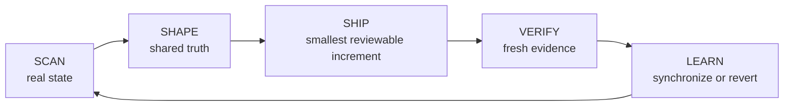

<div align="center">

<p><strong>AI SKILL · LOOP ENGINEERING · VERIFIED DELIVERY</strong></p>

# Swift Cycle

**From ambiguous requirements to verified AI delivery loops.**

A portable Agent Skill that turns evolving requirements into lightweight project structure, reviewable delivery increments, and evidence-backed outcomes—without importing heavyweight process.

<p>
  <a href="https://agentskills.io/specification"></a>
  <a href="https://github.com/Solismuchengxue/skill_swift_cycle/releases/latest"></a>
  <a href="LICENSE"></a>
  
</p>

[简体中文](README.zh-CN.md)

</div>

## Why Swift Cycle

AI-assisted delivery often breaks at the handoffs: requirements evolve, repository reality diverges from the plan, local execution notes become mistaken for shared truth, and “done” is declared without fresh evidence.

Swift Cycle reconnects those handoffs without turning a small project into a governance program. It inspects the real state, chooses process proportional to the task, ships the smallest reviewable increment, and synchronizes what was learned.

## Loop Engineering

**Loop Engineering is the discipline of keeping intent, execution, evidence, and learning connected in one short, repeatable feedback loop.**



The product model expands the loop; the execution rhythm stays intentionally short:

> Scan quickly → make the smallest useful change → verify immediately → continue or revert.

## AI Skill capabilities

| Capability | What Swift Cycle does |
| --- | --- |
| **Project shaping** | Reads the repository before acting, establishes only the useful project structure, and makes boundaries explicit. |
| **Persistent adoption** | Uses one explicit adoption to bind Swift Cycle in the project's `AGENTS.md`; later tasks load it through the project contract without repeated user commands. |
| **Background routing** | Detects adoption, ordinary progress, material structural change, or milestone closeout without showing a mode menu. |
| **Vision and confirmed requirements** | Separates long-term Blueprint intent from effective requirements and acceptance criteria; designs and schedules selected confirmed needs, not every idea. |
| **Conditional documents** | Reuses existing authorities and selects the smallest useful profile; ten fixed core templates do not become a mandatory document tree or conformance ledger. |
| **Document information architecture** | Keeps DESIGN concise, adds a docs home only when discoverability needs it, and organizes durable documents by real responsibility rather than a mandatory tree. |
| **Language adaptation** | Uses the caller, project, and file language for ordinary prose while preserving exact technical identifiers, standard statuses, and brand names. |
| **Semantic visualization** | Uses Figma editable sources plus PNG/SVG exports for architecture diagrams; other diagram types follow their semantics. Layout is project-driven, not a fixed container hierarchy. |
| **Governance Baseline** | Captures a proportional before-state when non-trivial governance needs reliable comparison across authority or delivery boundaries. |
| **Knowledge Promotion** | Moves durable commitments, decisions, constraints, and reusable evidence from local capture into responsibility-appropriate shared assets. |
| **State Separation** | Splits composite labels into only the independent lifecycle concerns a project actually tracks, checks local-record existence and Git-ignore state before treating them as private, and does not impose a fixed schema. |
| **Commit Boundary Planning** | Defines coherent, independently reviewable commit scopes before staging mixed, ordered, or multi-commit changes. |
| **Source/Runtime Boundary** | Keeps source, artifact, runtime, and consumer claims independently evidenced and authorized. |
| **Freshness and learning** | Detects stale status, freezes review snapshots, retires obsolete documents safely, and promotes confirmed failure guards. |
| **Adaptive execution** | Keeps small work in TODO, uses numbered milestone plans only when needed, and handles confirmed new requirements by adjusting future work. |
| **Evidence-backed delivery** | Keeps each increment reviewable, verifiable, and reversible, then continues or corrects based on fresh evidence. |
| **Portable package** | Ships one shared Skill without runtime scripts or dependencies; Figma is required when an architecture diagram is needed. Superpowers integration is conditional. |

## Quick Start

GitHub CLI 2.90 or later can install the same Skill for multiple agent hosts.

### Codex

```powershell
gh skill install Solismuchengxue/skill_swift_cycle swift-cycle --dir "$env:USERPROFILE\.agents\skills" --pin v1.4.0
```

In ChatGPT desktop, type `@` and select **Swift Cycle / 快速螺旋**. In Codex CLI or the IDE extension, invoke it with `$swift-cycle`.

Invoke it once to adopt or take over a project. After adoption, Swift Cycle records a persistent binding in the project's `AGENTS.md`; later project tasks load the Skill through that repository contract and do not require repeated mode selection or repeated explicit Skill selection/input.

### Claude Code

```powershell
gh skill install Solismuchengxue/skill_swift_cycle swift-cycle --agent claude-code --scope user
```

Invoke with `/swift-cycle`.

### GitHub Copilot

```powershell
gh skill install Solismuchengxue/skill_swift_cycle swift-cycle --agent github-copilot --scope user
```

Invoke with `/swift-cycle`.

For Codex project-only installation, replace `--dir "$env:USERPROFILE\.agents\skills"` with `--agent codex --scope project`. For the other hosts above, replace `--scope user` with `--scope project`. See [agent compatibility](docs/compatibility.md) for platform behavior and manual installation paths.

The Codex command explicitly installs fixed `v1.4.0` into the user `.agents/skills/swift-cycle` directory. Keep one independent real directory, not a duplicate legacy `.codex/skills/swift-cycle` entry or a Junction to the source. Before replacing an existing installation, preserve that Skill directory outside discovered Skill roots; then use the same command with `--force`. Restore only that directory to the same `.agents` destination to roll back, or reinstall the previous fixed tag with the same `--dir`. Installation metadata must never be written into the source checkout.

## What this project demonstrates

Swift Cycle is also an engineering portfolio artifact: it shows how a compact AI capability can be shaped, packaged, bounded, and verified for real delivery work.

| FDE capability | Repository evidence |
| --- | --- |
| **Solution shaping** | Turns ambiguous maintenance requests into explicit scope, document responsibilities, and delivery contracts. |
| **AI Skill productization** | Packages a working methodology as a portable Agent Skill with bilingual guidance and host-specific metadata. |
| **Delivery orchestration** | Selects lightweight execution for small work and dependency-aware, PR-sized increments for larger work. |
| **Evidence-first execution** | Connects implementation, validation, rollback, and shared-state synchronization instead of treating output as proof. |
| **Cross-context communication** | Maintains equivalent English and Chinese product narratives for technical and business-facing readers. |

## How it works

### Shared truth and local execution

| Authority | Responsibility |
| --- | --- |
| `docs/blueprint.md` or complete equivalent | Long-term vision, users, scenarios and product boundaries; not a promise to implement every idea. |
| `docs/requirements.md` or equivalent | Confirmed effective behavior, constraints and acceptance; implemented requirements remain effective. |
| `README.md` / `AGENTS.md` | User onboarding and help / project execution and authorization rules. |
| `DESIGN.md` and conditional `docs/architecture.md` | Overall solution and explanatory document guide / detailed architecture only when necessary. |
| Conditional `docs/roadmap.md` | Stage outcomes, dependencies and exit judgments that need independent maintenance. |
| `docs/milestones/milestone_N_plan.md` | One current formal implementation plan per complex milestone, with finite work packages. |
| Local `TODO.md` / `DEVLOG.md` | Current actions and next step / useful maintenance conclusions and reasons, not a copied completion history. |

Use one maintained body per fact; summaries link to it. Cross-session or cross-machine work alone does not justify a roadmap. TODO points to the active package rather than duplicating the plan.

Profiles (`minimal`, `standard`, `runtime_integration`) are internal starting points, not required trees or conformance tables. The ten core templates in [document responsibilities](skills/swift-cycle/references/document-profiles.md) preserve the approved Chinese heading order for new or approved whole-document restructuring, while ordinary edits preserve effective existing structure and prose language. Professional outlines remain optional candidates.

New ordinary docs paths use lowercase `snake_case`, with standard entry and index exceptions. Keep stable brownfield paths; rename only within an approved hygiene scope. Add a docs home only when discovery requires it. See [document organization](skills/swift-cycle/references/document-information-architecture.md).

### Governance boundaries

Swift Cycle activates governance only when repository evidence requires it:

- **Governance Baseline:** record the observed state before non-trivial governance, migration, replacement, or cross-boundary work; keep it separate from the intended outcome.
- **Knowledge Promotion:** promote durable commitments, decisions, constraints, and verified evidence into shared assets; keep short-term actions and one-off failures local.
- **State Separation:** separate a composite status only when it represents independent lifecycle questions with different closure evidence; check local records for existence and Git-ignore status before treating them as private.
- **Commit Boundary Planning:** plan coherent commit scopes before staging when changes have mixed purposes, ordered dependencies, or multiple reviewable increments.
- **Source/Runtime Boundary:** verify source, artifact, runtime, and active-consumer claims at their own layers; evidence and authorization do not transfer between them.
- **Documentation freshness:** reconcile status, decisions, plans, identities, and frozen Review Packets when real milestones or boundaries change.

These capabilities are trigger-based. Simple, local, explicit changes continue to use the short loop without extra governance artifacts.

### Proportional delivery

Small edits stay small. More complex stages use dependency-ordered packages, each containing implementation, necessary verification and affected documentation updates. Synchronize and converge after every package, not only at the end of the project. There are no fixed TODO history counts and no bulk transfer into DEVLOG.

New requirements are clarified and checked for impact before they enter current work. Update confirmed requirements first, then affected design, stage arrangements and actions. A new requirement after a completed stage belongs to future work; it does not automatically invalidate that stage's original completion.

A milestone must satisfy its overall outcome and necessary human confirmation, not merely checked tasks. Publishing, installation, deployment and real adoption remain separate permissions and evidence layers.

The source implements the approved [r29 engineering standard](docs/engineering_standard.md) and has passed D60 department-lead local-source acceptance. Publication and installation are separately verified in [delivery status](docs/compatibility.md#fixed-version-delivery). [Superpowers handoff conditions](skills/swift-cycle/references/superpowers-bridge.md) document the narrow optional integration; full execution, actual Figma drawing/export and real project adoption remain unverified.

## Example delivery loops

Codex CLI / IDE example:

```text
$swift-cycle Adopt this repository and bind lightweight ongoing maintenance in AGENTS.md.
```

After adoption, send normal project requests. The Agent detects the phase, profile, affected authorities, and closeout work in the background; there are no bootstrap, milestone, or closeout subcommands.

Use the invocation syntax supported by your agent host.

## Compatibility and boundaries

- Swift Cycle remains explicit-only at the Skill-system layer. A project uses one explicit adoption, then its committed `AGENTS.md` binding requires the Skill for later project tasks.
- Codex, Claude Code, and GitHub Copilot use the same canonical package with host-specific behavior documented in [agent compatibility](docs/compatibility.md).
- The canonical Skill body and default prompt are Simplified Chinese. The repository keeps bilingual product entry points and a concise terminology reference in [`references/zh-CN.md`](skills/swift-cycle/references/zh-CN.md); target project files still preserve their established language.
- The package follows the open [Agent Skills specification](https://agentskills.io/specification).
- The core package adds no scripts or runtime dependencies. Figma is the designated tool for architecture diagrams; optional integrations require their own available tools and permissions.

## Repository layout

```text
skill_swift_cycle/
├─ skills/swift-cycle/
│  ├─ SKILL.md
│  ├─ agents/openai.yaml
│  ├─ references/
│  │  ├─ adoption-and-routing.md
│  │  ├─ document-information-architecture.md
│  │  ├─ document-profiles.md
│  │  ├─ governance-boundaries.md
│  │  ├─ lifecycle-and-closeout.md
│  │  ├─ superpowers-bridge.md
│  │  └─ zh-CN.md
│  └─ templates/                 # Optional profile-aligned starting points
│     ├─ README.md / AGENTS.md
│     ├─ BLUEPRINT.md            # Renders to docs/blueprint.md
│     ├─ docs/                   # requirements, architecture, roadmap, numbered plan and optional references
│     ├─ DESIGN.md
│     ├─ DEVLOG.md
│     └─ TODO.md
├─ docs/engineering_standard.md # Approved source specification; not part of the Skill
├─ docs/compatibility.md
├─ README.md
├─ README.zh-CN.md
├─ DESIGN.md
├─ AGENTS.md
└─ LICENSE
```

Words in the repository name are separated with `_`. The standards-defined Skill name remains `swift-cycle` because Agent Skills names permit lowercase letters, digits, and hyphens.

## License

Swift Cycle is released under the [MIT License](LICENSE).
