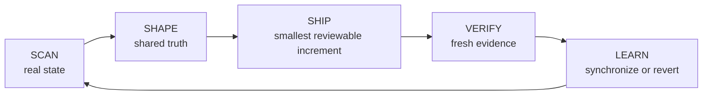

<div align="center">

<p><strong>AI SKILL · LOOP ENGINEERING · VERIFIED DELIVERY</strong></p>

# Swift Cycle

**From ambiguous requirements to verified AI delivery loops.**

A portable Agent Skill that turns evolving requirements into lightweight project structure, reviewable delivery increments, and evidence-backed outcomes—without importing heavyweight process.

<p>
  <a href="https://agentskills.io/specification"></a>
  <a href="https://github.com/Solismuchengxue/skill_swift_cycle/releases/latest"></a>
  <a href="LICENSE"></a>
  
</p>

[简体中文](README.zh-CN.md)

</div>

## Why Swift Cycle

AI-assisted delivery often breaks at the handoffs: requirements evolve, repository reality diverges from the plan, local execution notes become mistaken for shared truth, and “done” is declared without fresh evidence.

Swift Cycle reconnects those handoffs without turning a small project into a governance program. It inspects the real state, chooses process proportional to the task, ships the smallest reviewable increment, and synchronizes what was learned.

## Loop Engineering

**Loop Engineering is the discipline of keeping intent, execution, evidence, and learning connected in one short, repeatable feedback loop.**



The product model expands the loop; the execution rhythm stays intentionally short:

> Scan quickly → make the smallest useful change → verify immediately → continue or revert.

## AI Skill capabilities

| Capability | What Swift Cycle does |
| --- | --- |
| **Project shaping** | Reads the repository before acting, establishes only the useful project structure, and makes boundaries explicit. |
| **Persistent adoption** | Uses one explicit adoption to bind Swift Cycle in the project's `AGENTS.md`; later tasks load it through the project contract without repeated user commands. |
| **Background routing** | Detects adoption, ordinary progress, material structural change, or milestone closeout without showing a mode menu. |
| **Project intent baseline** | Creates a tracked `docs/blueprint.md` before substantive implementation in new projects, or maps a complete brownfield equivalent without creating a second authority. |
| **Document profiles** | Selects the smallest `minimal`, `standard`, or `runtime_integration` profile and records responsibility conformance without forcing a fixed document tree. |
| **Document information architecture** | Keeps DESIGN concise, adds a docs home only when discoverability needs it, and organizes durable documents by real responsibility rather than a mandatory tree. |
| **Language adaptation** | Uses the caller, project, and file language for ordinary prose while preserving exact technical identifiers, standard statuses, and brand names. |
| **Semantic visualization** | Visualizes only when it clarifies the reader's real question, selects the diagram from project facts, and reviews meaning, language, readability, permissions, and boundaries. |
| **Governance Baseline** | Captures a proportional before-state when non-trivial governance needs reliable comparison across authority or delivery boundaries. |
| **Knowledge Promotion** | Moves durable commitments, decisions, constraints, and reusable evidence from local capture into responsibility-appropriate shared assets. |
| **State Separation** | Splits composite labels into only the independent lifecycle concerns a project actually tracks, without imposing a fixed schema. |
| **Commit Boundary Planning** | Defines coherent, independently reviewable commit scopes before staging mixed, ordered, or multi-commit changes. |
| **Source/Runtime Boundary** | Keeps source, artifact, runtime, and consumer claims independently evidenced and authorized. |
| **Freshness and learning** | Detects stale status, freezes review snapshots, retires obsolete documents safely, and promotes confirmed failure guards. |
| **Adaptive execution** | Keeps simple work as a normal TODO; activates a milestone and dependency-ordered PR queue only when the work needs it. |
| **Evidence-backed delivery** | Keeps each increment reviewable, verifiable, and reversible, then continues or corrects based on fresh evidence. |
| **Portable orchestration** | Ships one standards-aligned Skill with localized guidance and host-specific metadata—without scripts, MCP servers, or external services. |

## Quick Start

GitHub CLI 2.90 or later can install the same Skill for multiple agent hosts.

### Codex

```powershell
gh skill install Solismuchengxue/skill_swift_cycle swift-cycle --agent codex --scope user
```

In ChatGPT desktop, type `@` and select **Swift Cycle / 快速螺旋**. In Codex CLI or the IDE extension, invoke it with `$swift-cycle`.

Invoke it once to adopt or take over a project. After adoption, Swift Cycle records a persistent binding in the project's `AGENTS.md`; later project tasks load the Skill through that repository contract and do not require repeated mode selection or repeated explicit Skill selection/input.

### Claude Code

```powershell
gh skill install Solismuchengxue/skill_swift_cycle swift-cycle --agent claude-code --scope user
```

Invoke with `/swift-cycle`.

### GitHub Copilot

```powershell
gh skill install Solismuchengxue/skill_swift_cycle swift-cycle --agent github-copilot --scope user
```

Invoke with `/swift-cycle`.

For project-only installation, replace `--scope user` with `--scope project`. See [agent compatibility](docs/compatibility.md) for platform behavior and manual installation paths.

## What this project demonstrates

Swift Cycle is also an engineering portfolio artifact: it shows how a compact AI capability can be shaped, packaged, bounded, and verified for real delivery work.

| FDE capability | Repository evidence |
| --- | --- |
| **Solution shaping** | Turns ambiguous maintenance requests into explicit scope, document responsibilities, and delivery contracts. |
| **AI Skill productization** | Packages a working methodology as a portable Agent Skill with bilingual guidance and host-specific metadata. |
| **Delivery orchestration** | Selects lightweight execution for small work and dependency-aware, PR-sized increments for larger work. |
| **Evidence-first execution** | Connects implementation, validation, rollback, and shared-state synchronization instead of treating output as proof. |
| **Cross-context communication** | Maintains equivalent English and Chinese product narratives for technical and business-facing readers. |

## How it works

### Shared truth and local execution

| Layer | Responsibility |
| --- | --- |
| `docs/blueprint.md` or mapped equivalent | Shared, tracked project intent: why, for whom, observable outcomes, scope, constraints, boundaries, and the next material decision. |
| `README.md` | User-facing value, installation, usage, and current limitations. |
| `DESIGN.md` + `docs/` | Durable design, requirements, roadmaps, evaluations, runbooks, and ADRs. |
| `AGENTS.md` | Repository-specific collaboration, safety, synchronization, and verification rules. |
| Local `TODO.md` | The current work surface; only larger work adds an active milestone, and older completion history moves out after the bounded recent window. |
| Local `DEVLOG.md` | Dated, evidence-oriented failures, corrections, reusable guards, decisions, and next gates—not a command transcript or second source of truth. |

The local TODO is an execution view, not the only long-term plan. Cross-machine commitments stay in a committable feasibility report, `docs/roadmap.md`, or a shared issue tracker.

After one explicit adoption, Swift Cycle detects the current phase and selects a document profile in the background:

- **`minimal`:** a project-intent baseline, existing core entry points, local execution records, and only necessary shared docs.
- **`standard`:** adds architecture, roadmap, evaluation, or ADR authorities only when corresponding durable facts exist.
- **`runtime_integration`:** activates when the current task must establish, change, or verify multiple operations, contract, security, storage, integration, or identity layers.

Profiles are starting configurations, not mandatory trees. Optional templates live under `templates/`, are adapted to the resolved file language, and include portable Blueprint, TODO, DEVLOG, and DESIGN starting points. Blueprint remains the sole intent authority; README, DESIGN, and docs indexes carry only short summaries and links.

When document volume, audience differences, or a flat layout harm discoverability, Swift Cycle keeps `DESIGN.md` as the concise architecture entry and conditionally adds `docs/README.md` as the broader docs home. Responsibility-based directories are created only for groups that need them; Diátaxis categories stay index metadata for purpose and audience rather than becoming a parallel directory tree.

New Markdown files and multiword directories under `docs/` use lowercase `snake_case`; root entry-point names and docs index `README.md` files retain their established exceptions. Brownfield naming drift is recorded and migrated only through an approved documentation-hygiene work package, never by copying a second authority. The canonical naming rules live in [document information architecture](skills/swift-cycle/references/document-information-architecture.md).

For adoption, material structural changes, and milestone closeout, the internal work package records `profile_conformance`: each responsibility is mapped to reuse existing, create, or not applicable, together with its single authority, reason, and update trigger. This record stays backstage unless it explains a risk or blocker.

### Governance boundaries

Swift Cycle activates governance only when repository evidence requires it:

- **Governance Baseline:** record the observed state before non-trivial governance, migration, replacement, or cross-boundary work; keep it separate from the intended outcome.
- **Knowledge Promotion:** promote durable commitments, decisions, constraints, and verified evidence into shared assets; keep short-term actions and one-off failures local.
- **State Separation:** separate a composite status only when it represents independent lifecycle questions with different closure evidence.
- **Commit Boundary Planning:** plan coherent commit scopes before staging when changes have mixed purposes, ordered dependencies, or multiple reviewable increments.
- **Source/Runtime Boundary:** verify source, artifact, runtime, and active-consumer claims at their own layers; evidence and authorization do not transfer between them.
- **Documentation freshness:** reconcile status, decisions, plans, identities, and frozen Review Packets when real milestones or boundaries change.

These capabilities are trigger-based. Simple, local, explicit changes continue to use the short loop without extra governance artifacts.

### Proportional delivery

- **Simple task:** the Agent keeps a normal TODO checklist and the short verification loop.
- **Multi-PR or milestone task:** the Agent activates a current milestone and dependency-ordered PR queue only when repository evidence requires it.
- **Every PR-sized increment:** record its ID, milestone, deliverable, scope, dependencies, verification, status, and PR link; keep it independently reviewable, verifiable, and reversible.

At milestone closeout, the Agent reconciles affected README, DESIGN, docs, TODO, DEVLOG, and active packets—or records why there is no documentation impact—without asking the user to choose a closeout mode.

Small, local changes stay lightweight. Swift Cycle does not require an RFC, ADR, design document, or PR queue for every edit.

## Example delivery loops

Codex CLI / IDE example:

```text
$swift-cycle Adopt this repository and bind lightweight ongoing maintenance in AGENTS.md.
```

After adoption, send normal project requests. The Agent detects the phase, profile, affected authorities, and closeout work in the background; there are no bootstrap, milestone, or closeout subcommands.

Use the invocation syntax supported by your agent host.

## Compatibility and boundaries

- Swift Cycle remains explicit-only at the Skill-system layer. A project uses one explicit adoption, then its committed `AGENTS.md` binding requires the Skill for later project tasks.
- Codex, Claude Code, and GitHub Copilot use the same canonical package with host-specific behavior documented in [agent compatibility](docs/compatibility.md).
- The canonical Skill body and default prompt are Simplified Chinese. The repository keeps bilingual product entry points and a concise terminology reference in [`references/zh-CN.md`](skills/swift-cycle/references/zh-CN.md); target project files still preserve their established language.
- The package follows the open [Agent Skills specification](https://agentskills.io/specification).
- No scripts, runtime dependencies, MCP servers, or external services are required.

## Repository layout

```text
skill_swift_cycle/
├─ skills/swift-cycle/
│  ├─ SKILL.md
│  ├─ agents/openai.yaml
│  ├─ references/
│  │  ├─ adoption-and-routing.md
│  │  ├─ document-information-architecture.md
│  │  ├─ document-profiles.md
│  │  ├─ governance-boundaries.md
│  │  ├─ lifecycle-and-closeout.md
│  │  └─ zh-CN.md
│  └─ templates/                 # Optional profile-aligned starting points
│     ├─ BLUEPRINT.md            # Renders to docs/blueprint.md
│     ├─ DESIGN.md
│     ├─ DEVLOG.md
│     └─ TODO.md
├─ docs/compatibility.md
├─ README.md
├─ README.zh-CN.md
├─ DESIGN.md
├─ AGENTS.md
└─ LICENSE
```

Words in the repository name are separated with `_`. The standards-defined Skill name remains `swift-cycle` because Agent Skills names permit lowercase letters, digits, and hyphens.

## License

Swift Cycle is released under the [MIT License](LICENSE).
