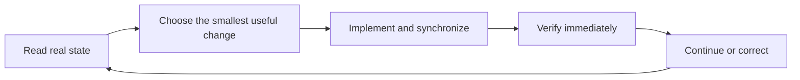

<div align="center">

# Swift Cycle

**Adopt once. Keep one project coherent through a lightweight engineering loop.**

Connect project intent, confirmed requirements, implementation, verification and learning, with a clear result and next step for every change.

[](https://github.com/Solismuchengxue/skill_swift_cycle/releases)
[](LICENSE)
[](https://agentskills.io/specification)

[简体中文](README.zh-CN.md) · [✨ Features](#features) · [🚀 Quick start](#quick-start) · [🎬 First use](#first-use) · [❓ Help](#help)

</div>

> **Version note:** this page describes the current source. The fixed installation command below selects released v1.4.0, which does not include later initialization, template, reference or tmp/ revisions. Source, releases and installed copies are separate; see [delivery and verification records](docs/compatibility.md#fixed-version-delivery).

---

<a id="features"></a>
<a id="why-swift-cycle"></a>
<a id="loop-engineering"></a>
<a id="ai-skill-capabilities"></a>
<a id="what-this-project-demonstrates"></a>
<a id="how-it-works"></a>
<a id="shared-truth-and-local-execution"></a>
<a id="governance-boundaries"></a>
<a id="proportional-delivery"></a>

## ✨ Purpose and scope

Swift Cycle is a document-based Skill following the Agent Skills specification. It reads the real project first, then selects the smallest useful change, verification and documentation work for the task. Simple work stays simple.

| Core capability | What it helps you do |
| :--- | :--- |
| **Adoption and ongoing work** | Bind the Skill in the project's AGENTS.md after one explicit adoption, then send normal project requests |
| **Separate intent from requirements** | Keep goals and ideas in BLUEPRINT, confirmed behavior and acceptance in PRD, without promising every idea |
| **Readable progress and learning** | Use TODO for progress, milestone position, problems and the next stage; keep useful conclusions and reasons in DEVLOG |
| **Conditional document templates** | Reuse ten core outlines plus optional MANUAL/ADR; README has visual navigation, DESIGN has an overview and UML |
| **Converge after each package** | Complete implementation, proportional verification and affected guidance together; schedule new requirements prospectively |
| **Reuse and lightweight governance** | Find existing capabilities, organize by real responsibility, and check identities, commit boundaries or freshness when needed |
| **Local temporary workspace** | Keep controllable temporary work in root tmp/ under the applicable Git-ignore policy, reducing extra C-drive writes |
| **Portability and language adaptation** | Share one canonical package; respect file/project prose languages while preserving commands, paths and standard identifiers |

**Suitable for:** personal projects, small team repositories, ongoing maintenance and bounded engineering tasks.

**Outside its scope:** organizational routing, capacity management, cross-project runtime authority, and publication, installation, deployment or deletion without authorization.

### 🔁 The short loop



Loop Engineering keeps intent, execution, evidence and learning connected in this short cycle. Ordinary work uses a normal TODO; complex stages use one stable numbered formal plan when needed.

## 🧰 Prerequisites

| Item | Requirement |
| :--- | :--- |
| Agent environment | An Agent Skills host; invocation syntax and verification scope are documented in [compatibility](docs/compatibility.md) |
| Installation tooling | For the commands below, GitHub CLI with gh skill; check local support with `gh skill install --help` |
| Project material | The current directory, existing instructions, requirements, design and Git state; report gaps and unknowns honestly |
| Write access | Modify only the authorized project; read-only tasks create no directories, ignore rules or records |
| Diagram tooling | New or whole-document DESIGN restructuring requires editable Figma architecture sources and PNG/SVG; ordinary prose edits do not require Figma |

The Skill itself adds no runtime scripts or dependency packages. Local reading and maintenance do not require a new cloud account; external tools and permissions depend on the actual task.

<a id="quick-start"></a>
<a id="codex"></a>
<a id="claude-code"></a>
<a id="github-copilot"></a>

## 🚀 Install or connect

### 💻 Install a fixed version for Codex

**Working directory:** anywhere gh is available. **Shell:** Windows PowerShell 7.

```powershell
gh skill install Solismuchengxue/skill_swift_cycle swift-cycle --dir "$env:USERPROFILE\.agents\skills" --pin v1.4.0
```

**Success check:** the complete Skill is under the user .agents/skills/swift-cycle directory, with its source visible in `gh skill list`. In ChatGPT desktop, type `@` and choose **Swift Cycle / 快速螺旋**. In Codex CLI/IDE, use `$swift-cycle`.

Before replacing an existing installation, preserve its directory for rollback and explicitly choose the replacement. Keep one independent real entry; avoid a duplicate legacy .codex/skills copy or a Junction into source. Selecting another version and editing this repository do not update an installed copy automatically.

### 📦 Other ways to connect

| Scenario | Route |
| :--- | :--- |
| Claude Code | `gh skill install Solismuchengxue/skill_swift_cycle swift-cycle --agent claude-code --scope user --pin v1.4.0`; invoke /swift-cycle |
| GitHub Copilot CLI | `gh skill install Solismuchengxue/skill_swift_cycle swift-cycle --agent github-copilot --scope user --pin v1.4.0`; invoke /swift-cycle, without assuming that syntax in other interfaces |
| Codex project-only installation | Replace --dir and its value in the Codex command with --agent codex --scope project |
| Manually install current source | Copy the entire skills/swift-cycle/ package to the host's supported Skill directory, including references, templates and metadata; first resolve backup and version selection for an existing installation |
| Maintain this repository | Follow [AGENTS.md](AGENTS.md#swift-cycle) and read the in-repository canonical entry; documentation editing does not require replacing the user's installed Skill |

Manual paths, installed sources and rollback boundaries are covered in [compatibility](docs/compatibility.md#manual-installation).

<a id="first-use"></a>
<a id="example-delivery-loops"></a>

## 🎬 First use

### 📥 1. Prepare the input

Open an existing project and define the task's scope. A first read-only check does not need a new document tree.

### ▶️ 2. Select the Skill and request a task

In ChatGPT desktop, select the Skill through `@`, then send:

```text
Read this project's README, DESIGN and existing requirements.
Report current progress, observed problems and the next step.
Do not modify files, commit or push.
```

In Codex CLI/IDE, prefix the same request with `$swift-cycle`. A one-off review does not create persistent adoption. For ongoing use, explicitly request: “Adopt Swift Cycle and bind it in this project's AGENTS.md.”

### ✅ 3. Check the result

Expect a file-backed status, findings, unverified scope and next step, without claims of unauthorized document creation. This is an example request, not a new host-execution test result.

After adoption, send normal project tasks. Valid root TODO.md and DEVLOG.md become required only for authorized project creation or formal initialization. Existing valid records are preserved; ordinary maintenance synchronizes affected content.

<a id="help"></a>
<a id="repository-layout"></a>

## 🛠️ Everyday use and help

### 📋 Common tasks and document entry points

| Goal | Action or entry point |
| :--- | :--- |
| Advance existing work | State the goal, scope and preserved items; reconcile the current TODO, then complete the smallest work package and its verification |
| Receive a new requirement | Confirm behavior, acceptance and impact first; schedule additions after completed stages without rewriting the original completion scope |
| Read the design, directory tree and UML | [Project overview design](DESIGN.md) |
| Choose documents, names or record policy | [Project structure and document rules](skills/swift-cycle/references/document-profiles.md) |
| Find synchronization and closeout triggers | [Requirements and continuous convergence](skills/swift-cycle/references/lifecycle-and-closeout.md) |
| Check installation, versions and actual evidence | [Compatibility and evidence](docs/compatibility.md) |
| Maintain this Skill | [Execution rules](AGENTS.md), [source standard](docs/engineering_standard.md), [canonical entry](skills/swift-cycle/SKILL.md) |

### ❓ Frequently asked questions

<details>
<summary>Why does v1.4.0 lack the templates in current source?</summary>

A fixed tag does not follow main. Use the [delivery record](docs/compatibility.md#fixed-version-delivery) to distinguish versions; explicitly choose a new source and preserve rollback before updating. Editing source is not an installation.

</details>

<details>
<summary>Will every project get ROADMAP, MANUAL and all templates?</summary>

No. Reuse complete equivalents and fill only real responsibilities. State honestly when no milestones exist. MANUAL, detailed SAD and numbered plans are conditional.

</details>

<details>
<summary>Can tmp/ be emptied automatically?</summary>

Central storage does not grant deletion authority. Check the purpose and authorization for existing material, tracked files, user data and recovery points. Read-only tasks neither create nor clean tmp/.

</details>

For unresolved problems, use [GitHub Issues](https://github.com/Solismuchengxue/skill_swift_cycle/issues) with the host, Skill source/version, reproduction steps and sanitized errors. Do not attach credentials or private material.

<a id="compatibility-and-boundaries"></a>
<a id="license"></a>

## 📄 Limits and license

- **Evidence scope:** package validation, source assertions, isolated fixtures, host discovery and actual invocation are separate layers. See [dated compatibility records](docs/compatibility.md). Drawing for this repository does not prove adoption by other projects, fresh agents or other hosts.
- **External tools:** architecture diagrams use Figma. Local static checks do not establish full Superpowers execution, other hosts or long-term behavior.
- **Authority:** the Skill grants no publication, installation, deployment, credential, cost, deletion or consumer-switching permission. Local-record privacy depends on the actual Git policy.
- **License:** [MIT License](LICENSE). Installer-added source metadata belongs to installed copies and must not enter canonical source.

## ⭐ Star History

[](https://github.com/Solismuchengxue/skill_swift_cycle/stargazers)
