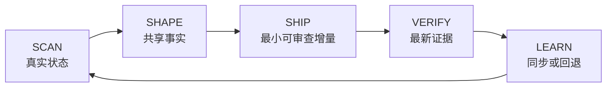

<div align="center">

<p><strong>AI SKILL · LOOP ENGINEERING · VERIFIED DELIVERY</strong></p>

# Swift Cycle（快速螺旋）

**把模糊需求转化为经过验证的 AI 交付循环。**

一个可移植的 Agent Skill：把持续变化的需求转化为轻量项目结构、可独立审查的交付增量和有证据支撑的结果，同时避免引入笨重流程。

<p>
  <a href="https://agentskills.io/specification"></a>
  <a href="https://github.com/Solismuchengxue/skill_swift_cycle/releases/latest"></a>
  <a href="LICENSE"></a>
  
</p>

[English](README.md)

</div>

## 为什么需要 Swift Cycle

AI 辅助交付最容易在衔接处失真：需求持续变化，仓库真实状态偏离计划，本地执行记录被误当成长期共享事实，而“完成”缺少最新验证证据。

Swift Cycle 把这些衔接重新接成一个短循环，同时不把小项目升级为治理工程。它先检查真实状态，再选择与任务规模相称的流程，交付最小可审查增量，并同步本轮学到的事实。

## Loop Engineering

**Loop Engineering 是让意图、执行、证据与学习始终连接在一个短小、可重复反馈循环中的工程纪律。**



产品模型展开了循环，但执行节奏仍刻意保持简短：

> 快速扫描 → 最小变更 → 立即验证 → 继续或回退。

## AI Skill 能力

| 能力 | Swift Cycle 的做法 |
| --- | --- |
| **项目塑形** | 行动前先读取仓库，只建立真正有用的项目结构，并明确边界。 |
| **持久采用** | 只需一次显式采用，即在项目 `AGENTS.md` 建立绑定；后续任务通过项目合同加载，无需重复输入。 |
| **后台路由** | 自动识别首次采用、普通推进、重大结构变化或里程碑关闭，不向用户展示模式菜单。 |
| **项目意图基线** | 新项目在实质实施前创建受跟踪的 `docs/blueprint.md`；旧项目则映射完整等价权威，不制造第二真源。 |
| **文档档位** | 自动选择最小的 `minimal`、`standard` 或 `runtime_integration`，并记录职责一致性，不强制固定文档树。 |
| **文档信息架构** | 保持 DESIGN 简洁，只在可发现性确有需要时增加 docs home，并按真实职责而非固定树组织长期文档。 |
| **语言自动适配** | 普通内容服从调用者、项目和文件语言，同时保持技术标识、标准状态和品牌名的准确原文。 |
| **语义化可视表达** | 只在有助于回答真实读者问题时可视化，依据项目事实选择图型，并审查语义、语言、可读性、权限与边界。 |
| **治理基线（Governance Baseline）** | 非简单治理需要跨权威或交付边界可靠比较时，记录与任务规模相称的变更前状态。 |
| **知识晋升（Knowledge Promotion）** | 把长期承诺、决策、约束和可复用证据从本地记录晋升到职责匹配的共享资产。 |
| **状态拆分（State Separation）** | 只拆分项目实际跟踪的独立生命周期问题，不引入固定状态 Schema。 |
| **提交边界规划（Commit Boundary Planning）** | 在暂存混合目的、有顺序依赖或多提交修改前，定义一致且可独立审查的提交范围。 |
| **源码/运行态边界（Source/Runtime Boundary）** | 让源码、制品、运行态和消费者结论分别拥有自己的证据与授权。 |
| **新鲜度与学习闭环** | 识别过期状态，冻结审查快照，安全退役旧文档，并晋升已确认的失败防线。 |
| **自适应执行** | 简单任务保留普通 TODO；只有工作真正需要时，才启用里程碑与按依赖排序的 PR 队列。 |
| **证据驱动交付** | 让每个增量都可审查、可验证、可回退，再根据最新证据继续或修正。 |
| **可移植编排** | 以一份符合标准的 Skill 配合本地化指引和宿主元数据，不依赖脚本、MCP Server 或外部服务。 |

## 快速开始

GitHub CLI 2.90 或更高版本可以把同一份 Skill 安装给多个 Agent。

### Codex

```powershell
gh skill install Solismuchengxue/skill_swift_cycle swift-cycle --agent codex --scope user
```

在 ChatGPT 桌面端，输入 `@` 并选择 **Swift Cycle / 快速螺旋**；在 Codex CLI 或 IDE 扩展中，使用 `$swift-cycle` 调用。

首次初始化或接管项目时调用一次。采用后，Swift Cycle 会在项目 `AGENTS.md` 写入持久绑定；后续项目任务通过该仓库合同加载 Skill，不要求用户重复选择模式或重复显式选择/输入 Skill。

### Claude Code

```powershell
gh skill install Solismuchengxue/skill_swift_cycle swift-cycle --agent claude-code --scope user
```

使用 `/swift-cycle` 调用。

### GitHub Copilot

```powershell
gh skill install Solismuchengxue/skill_swift_cycle swift-cycle --agent github-copilot --scope user
```

使用 `/swift-cycle` 调用。

如果只希望当前项目使用，把 `--scope user` 改为 `--scope project`。不同平台的行为和手动安装路径见[兼容性说明](docs/compatibility.md)。

## 项目体现的工程能力

Swift Cycle 同时也是一个工程作品集项目：这个仓库展示了如何把紧凑的 AI 能力塑形、产品化、划定边界，并用真实验证支持交付。

| FDE 能力 | 仓库证据 |
| --- | --- |
| **方案塑形** | 把模糊的维护请求转化为明确范围、文档职责和交付合同。 |
| **AI Skill 产品化** | 把工作方法封装为可移植 Agent Skill，并维护双语指引与宿主专属元数据。 |
| **交付编排** | 小任务采用轻量执行，大任务拆成依赖明确、PR 大小的交付增量。 |
| **证据优先执行** | 连接实施、验证、回退与共享状态同步，不把输出本身当作完成证据。 |
| **跨语境沟通** | 为技术与业务读者维护语义一致的中英文产品叙事。 |

## 工作方式

### 共享事实与本地执行

| 层级 | 职责 |
| --- | --- |
| `docs/blueprint.md` 或映射的等价权威 | 共享、受跟踪的项目意图：为什么做、为谁做、可观察结果、范围、约束、边界和下一项关键决定。 |
| `README.md` | 面向用户的价值、安装、用法与当前限制。 |
| `DESIGN.md` + `docs/` | 可长期共享的设计、需求、路线图、评估、运行手册与 ADR。 |
| `AGENTS.md` | 仓库级协作、安全、同步与验证规则。 |
| 本地 `TODO.md` | 当前工作面；只有较大工作才加入当前里程碑，较早完成历史会在有界近期窗口后迁出。 |
| 本地 `DEVLOG.md` | 按日期、按证据记录失败、修正、可复用防线、决定和下一门槛；不是命令转录或第二事实源。 |

本地 TODO 是当前执行视图，不是唯一长期计划。跨机器承诺继续放在可提交的可行性报告、`docs/roadmap.md` 或共享 Issue Tracker 中。

一次显式采用后，Swift Cycle 在后台识别当前阶段并选择文档档位：

- **`minimal`：**覆盖项目意图基线，并沿用核心入口、本地执行记录和确有需要的共享文档。
- **`standard`：**只在存在对应长期事实时增加 architecture、roadmap、evaluation 或 ADR。
- **`runtime_integration`：**只有当前任务需要建立、改变或验证多个运维、合同、安全、存储、集成或身份层时才启用。

配置是起点，不是强制目录树。`templates/` 中的可选模板会按解析后的文件语言生成，并提供可移植的 Blueprint、TODO、DEVLOG 与 DESIGN 起点。Blueprint 保持唯一意图权威；README、DESIGN 和 docs 索引只放短摘要与链接。

当文档数量、受众差异或平铺结构影响可发现性时，Swift Cycle 让 `DESIGN.md` 继续承担简洁架构入口，并按需增加 `docs/README.md` 作为完整 docs home。只有真正需要分组的职责才建立子目录；Diátaxis 分类只作为用途与受众索引元数据，不复制成第二套目录树。

`docs/` 下新建 Markdown 文件和多单词目录统一使用小写 `snake_case`；根目录约定入口和 docs 索引 `README.md` 保留生态例外。旧项目命名偏差先记录，只有获准的 documentation-hygiene 工作包才迁移，绝不复制第二权威。完整命名规则以[文档信息架构](skills/swift-cycle/references/document-information-architecture.md)为准。

在采用、重大结构变化和里程碑关闭时，内部工作包维护 `profile_conformance`：每项职责映射为“复用现有 / 新建 / 不适用”，并记录唯一权威、理由和更新触发。除非它直接解释风险或 blocker，否则不向用户展开。

### 治理边界

Swift Cycle 只在仓库证据要求时启用相应治理能力：

- **治理基线：**在非简单治理、迁移、替换或跨边界工作前记录已观察状态，并与目标结果分开。
- **知识晋升：**把长期承诺、决策、约束和已验证证据晋升到共享资产；短期行动和单次失败继续留在本地。
- **状态拆分：**只有一个状态同时代表多个关闭证据不同的生命周期问题时，才拆分独立状态。
- **提交边界规划：**修改包含混合目的、顺序依赖或多个可审查增量时，在暂存前规划一致的提交范围。
- **源码/运行态边界：**分别验证源码、制品、运行态和活动消费者；证据与授权不能跨层传递。
- **文档新鲜度：**真实里程碑或边界变化时，对齐状态、决策、计划、身份和冻结的 Review Packet。

这些能力均由实际触发条件启用。简单、局部且明确的修改仍使用短循环，不增加额外治理产物。

### 与任务规模相称的交付方式

- **简单任务：**Agent 使用普通 TODO 清单与短验证循环。
- **多 PR 或里程碑任务：**只有仓库证据确实需要时，Agent 才启用当前里程碑与按依赖排序的 PR 队列。
- **每个 PR 大小的增量：**记录 ID、里程碑、交付物、范围、依赖、验证、状态与 PR 链接，并确保它可独立审查、验证和回退。

里程碑关闭时，Agent 自动收敛受影响的 README、DESIGN、docs、TODO、DEVLOG 和活动 Packet；没有文档影响时记录理由，不再要求用户选择 closeout 模式。

简单、局部的修改继续保持轻量。Swift Cycle 不要求每次编辑都创建 RFC、ADR、设计文档或 PR 队列。

## 交付循环示例

Codex CLI / IDE 示例：

```text
$swift-cycle 接管当前仓库，并在 AGENTS.md 中绑定持续的轻量维护。
```

采用后直接发送普通项目任务。Agent 在后台判断阶段、档位、受影响权威和收敛工作；不提供 bootstrap、milestone 或 closeout 子命令。

请根据所用 Agent 调整调用语法。

## 兼容性与边界

- Swift Cycle 在系统层保持 explicit-only。项目只需一次显式采用，之后由已提交的 `AGENTS.md` 绑定要求后续项目任务加载该 Skill。
- Codex、Claude Code 与 GitHub Copilot 使用同一份规范包；宿主差异见[兼容性说明](docs/compatibility.md)。
- canonical Skill 正文和默认提示使用简体中文。仓库继续维护双语产品入口，以及 [`references/zh-CN.md`](skills/swift-cycle/references/zh-CN.md) 中的精简术语；目标项目文件仍沿用其既有语言。
- 该包遵循开放的 [Agent Skills 规范](https://agentskills.io/specification)。
- 不需要脚本、运行时依赖、MCP Server 或外部服务。

## 仓库结构

```text
skill_swift_cycle/
├─ skills/swift-cycle/
│  ├─ SKILL.md
│  ├─ agents/openai.yaml
│  ├─ references/
│  │  ├─ adoption-and-routing.md
│  │  ├─ document-information-architecture.md
│  │  ├─ document-profiles.md
│  │  ├─ governance-boundaries.md
│  │  ├─ lifecycle-and-closeout.md
│  │  └─ zh-CN.md
│  └─ templates/                 # 按需使用的文档配置起点
│     ├─ BLUEPRINT.md            # 应用为 docs/blueprint.md
│     ├─ DESIGN.md
│     ├─ DEVLOG.md
│     └─ TODO.md
├─ docs/compatibility.md
├─ README.md
├─ README.zh-CN.md
├─ DESIGN.md
├─ AGENTS.md
└─ LICENSE
```

仓库名中的多个单词使用 `_` 连接。Skill 名继续使用 `swift-cycle`，因为 Agent Skills 名称只允许小写字母、数字和连字符。

## 许可证

Swift Cycle 使用 [MIT License](LICENSE) 发布。
