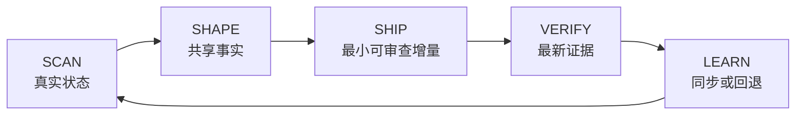

<div align="center">

<p><strong>AI SKILL · LOOP ENGINEERING · VERIFIED DELIVERY</strong></p>

# Swift Cycle（快速螺旋）

**把模糊需求转化为经过验证的 AI 交付循环。**

一个可移植的 Agent Skill：把持续变化的需求转化为轻量项目结构、可独立审查的交付增量和有证据支撑的结果，同时避免引入笨重流程。

<p>
  <a href="https://agentskills.io/specification"></a>
  <a href="https://github.com/Solismuchengxue/skill_swift_cycle/releases/latest"></a>
  <a href="LICENSE"></a>
  
</p>

[English](README.md)

</div>

## 为什么需要 Swift Cycle

AI 辅助交付最容易在衔接处失真：需求持续变化，仓库真实状态偏离计划，本地执行记录被误当成长期共享事实，而“完成”缺少最新验证证据。

Swift Cycle 把这些衔接重新接成一个短循环，同时不把小项目升级为治理工程。它先检查真实状态，再选择与任务规模相称的流程，交付最小可审查增量，并同步本轮学到的事实。

## Loop Engineering

**Loop Engineering 是让意图、执行、证据与学习始终连接在一个短小、可重复反馈循环中的工程纪律。**



产品模型展开了循环，但执行节奏仍刻意保持简短：

> 快速扫描 → 最小变更 → 立即验证 → 继续或回退。

## AI Skill 能力

| 能力 | Swift Cycle 的做法 |
| --- | --- |
| **项目塑形** | 行动前先读取仓库，只建立真正有用的项目结构，并明确边界。 |
| **持久采用** | 只需一次显式采用，即在项目 `AGENTS.md` 建立绑定；后续任务通过项目合同加载，无需重复输入。 |
| **后台路由** | 自动识别首次采用、普通推进、重大结构变化或里程碑关闭，不向用户展示模式菜单。 |
| **愿景与确认需求** | 蓝图说明长期愿景，需求说明承载有效行为与验收；按所选确认需求设计和安排，不把全部设想变成承诺。 |
| **按需文档** | 先复用现有权威，再选择最小职责；十份固定核心模板不意味着生成整套文档或裁剪账本。 |
| **文档信息架构** | 保持 DESIGN 简洁，只在可发现性确有需要时增加 docs home，并按真实职责而非固定树组织长期文档。 |
| **语言自动适配** | 普通内容服从调用者、项目和文件语言，同时保持技术标识、标准状态和品牌名的准确原文。 |
| **语义化图示** | 架构图使用 Figma 可编辑原稿及 PNG/SVG，其他图按关系语义选型；布局由项目决定，不强制容器层级。 |
| **治理基线（Governance Baseline）** | 非简单治理需要跨权威或交付边界可靠比较时，记录与任务规模相称的变更前状态。 |
| **知识晋升（Knowledge Promotion）** | 把长期承诺、决策、约束和可复用证据从本地记录晋升到职责匹配的共享资产。 |
| **状态拆分（State Separation）** | 只拆分项目实际跟踪的独立生命周期问题，在把本地记录视为私有状态前核对存在与忽略状态，不引入固定状态 Schema。 |
| **提交边界规划（Commit Boundary Planning）** | 在暂存混合目的、有顺序依赖或多提交修改前，定义一致且可独立审查的提交范围。 |
| **源码/运行态边界（Source/Runtime Boundary）** | 让源码、制品、运行态和消费者结论分别拥有自己的证据与授权。 |
| **新鲜度与学习闭环** | 识别过期状态，冻结审查快照，安全退役旧文档，并晋升已确认的失败防线。 |
| **自适应执行** | 小任务使用 TODO，复杂阶段才用编号计划；新确认需求按影响前瞻调整，不无故推翻已完成阶段。 |
| **证据驱动交付** | 让每个增量都可审查、可验证、可回退，再根据最新证据继续或修正。 |
| **可移植包** | 一份共享 Skill 不新增运行脚本或依赖；需要架构图时使用 Figma，Superpowers 只按已核对条件衔接。 |

## 快速开始

GitHub CLI 2.90 或更高版本可以把同一份 Skill 安装给多个 Agent。

### Codex

```powershell
gh skill install Solismuchengxue/skill_swift_cycle swift-cycle --dir "$env:USERPROFILE\.agents\skills" --pin v1.4.0
```

在 ChatGPT 桌面端，输入 `@` 并选择 **Swift Cycle / 快速螺旋**；在 Codex CLI 或 IDE 扩展中，使用 `$swift-cycle` 调用。

首次初始化或接管项目时调用一次。采用后，Swift Cycle 会在项目 `AGENTS.md` 写入持久绑定；后续项目任务通过该仓库合同加载 Skill，不要求用户重复选择模式或重复显式选择/输入 Skill。

### Claude Code

```powershell
gh skill install Solismuchengxue/skill_swift_cycle swift-cycle --agent claude-code --scope user
```

使用 `/swift-cycle` 调用。

### GitHub Copilot

```powershell
gh skill install Solismuchengxue/skill_swift_cycle swift-cycle --agent github-copilot --scope user
```

使用 `/swift-cycle` 调用。

Codex 仅在当前项目安装时，把 `--dir "$env:USERPROFILE\.agents\skills"` 替换为 `--agent codex --scope project`；上述其他宿主则把 `--scope user` 改为 `--scope project`。不同平台的行为和手动安装路径见[兼容性说明](docs/compatibility.md)。

上述 Codex 命令将固定 `v1.4.0` 显式安装到用户级 `.agents/skills/swift-cycle`。只保留一份独立真实目录，不保留旧 `.codex/skills/swift-cycle` 重复入口或指向源码的 Junction。更新已有安装前，先把这一份技能目录备份到发现入口之外，再使用同一命令加 `--force`；回退只恢复该目录到同一 `.agents` 目标，或保留相同 `--dir` 重新安装旧固定标签。安装元数据不得写入源码仓库。

## 项目体现的工程能力

Swift Cycle 同时也是一个工程作品集项目：这个仓库展示了如何把紧凑的 AI 能力塑形、产品化、划定边界，并用真实验证支持交付。

| FDE 能力 | 仓库证据 |
| --- | --- |
| **方案塑形** | 把模糊的维护请求转化为明确范围、文档职责和交付合同。 |
| **AI Skill 产品化** | 把工作方法封装为可移植 Agent Skill，并维护双语指引与宿主专属元数据。 |
| **交付编排** | 小任务采用轻量执行，大任务拆成依赖明确、PR 大小的交付增量。 |
| **证据优先执行** | 连接实施、验证、回退与共享状态同步，不把输出本身当作完成证据。 |
| **跨语境沟通** | 为技术与业务读者维护语义一致的中英文产品叙事。 |

## 工作方式

### 共享事实与本地执行

| 权威 | 职责 |
| --- | --- |
| `docs/blueprint.md` 或完整等价来源 | 长期愿景、用户、场景与产品边界，不承诺实现全部设想。 |
| `docs/requirements.md` 或等价来源 | 已确认有效行为、约束与验收；已实现且仍有效的需求继续保留。 |
| `README.md` / `AGENTS.md` | 用户上手与求助 / 项目执行和授权规则。 |
| `DESIGN.md` 与按需的 `docs/architecture.md` | 总体办法及详细文档导读 / 简洁设计不足以承载时才独立架构。 |
| 按需的 `docs/roadmap.md` | 需要独立维护的阶段结果、依赖和退出判断。 |
| `docs/milestones/milestone_N_plan.md` | 一个复杂里程碑的一份现行正式实施计划及有限工作包。 |
| 本地 `TODO.md` / `DEVLOG.md` | 当前行动与下一步 / 有效维护结论与理由，不复制完成历史。 |

一事一处，其他位置摘要并链接。跨会话或跨机器本身不要求路线图。TODO 指向当前包，不复制整份计划。

文档档位（`minimal`、`standard`、`runtime_integration`）只是内部起点，不要求文档树或裁剪表。[文档职责](skills/swift-cycle/references/document-profiles.md) 中的十份核心模板保留已确认中文栏目顺序；新建或获准整体重整时使用，小改动保留有效等价结构和文件语言。专业提纲仍是按需候选。

新普通 docs 路径用小写 `snake_case`，生态入口和索引保留例外。已有稳定路径不自动改名，迁移须在获准整理范围内进行；查找困难时才加 docs 首页。详见[文档组织](skills/swift-cycle/references/document-information-architecture.md)。

### 治理边界

Swift Cycle 只在仓库证据要求时启用相应治理能力：

- **治理基线：**在非简单治理、迁移、替换或跨边界工作前记录已观察状态，并与目标结果分开。
- **知识晋升：**把长期承诺、决策、约束和已验证证据晋升到共享资产；短期行动和单次失败继续留在本地。
- **状态拆分：**只有一个状态同时代表多个关闭证据不同的生命周期问题时，才拆分独立状态；把本地记录视为私有状态前，先核对存在与 Git 忽略状态。
- **提交边界规划：**修改包含混合目的、顺序依赖或多个可审查增量时，在暂存前规划一致的提交范围。
- **源码/运行态边界：**分别验证源码、制品、运行态和活动消费者；证据与授权不能跨层传递。
- **文档新鲜度：**真实里程碑或边界变化时，对齐状态、决策、计划、身份和冻结的 Review Packet。

这些能力均由实际触发条件启用。简单、局部且明确的修改仍使用短循环，不增加额外治理产物。

### 与任务规模相称的交付方式

小改动保持简单。复杂阶段按依赖分包，每包包含实现、必要验证和受影响说明同步。每包都收敛，不等项目末尾；TODO 不设固定历史条数，旧完成项不整批搬入 DEVLOG。

新需求先明确问题、验收和影响，再决定加入、替换或后移。先更新确认需求，再同步相关设计、阶段安排和行动。已完成阶段之后的新需求安排后续工作，不无故把原阶段改成未完成。

里程碑须满足总体结果与必要人工确认，不以任务全勾选代替。发布、安装、部署及真实采用仍是不同授权与证据层。

源码按已批准的 [r29 工程规约](docs/engineering_standard.md) 实现，D60 部长已验收本地源码；发布和安装在[交付状态](docs/compatibility.md#fixed-version-delivery)分别核对。[Superpowers 衔接条件](skills/swift-cycle/references/superpowers-bridge.md) 仅说明已核对的最小接口；完整执行、Figma 实际绘制导出与真实项目采用仍未验证。

## 交付循环示例

Codex CLI / IDE 示例：

```text
$swift-cycle 接管当前仓库，并在 AGENTS.md 中绑定持续的轻量维护。
```

采用后直接发送普通项目任务。Agent 在后台判断阶段、档位、受影响权威和收敛工作；不提供 bootstrap、milestone 或 closeout 子命令。

请根据所用 Agent 调整调用语法。

## 兼容性与边界

- Swift Cycle 在系统层保持 explicit-only。项目只需一次显式采用，之后由已提交的 `AGENTS.md` 绑定要求后续项目任务加载该 Skill。
- Codex、Claude Code 与 GitHub Copilot 使用同一份规范包；宿主差异见[兼容性说明](docs/compatibility.md)。
- canonical Skill 正文和默认提示使用简体中文。仓库继续维护双语产品入口，以及 [`references/zh-CN.md`](skills/swift-cycle/references/zh-CN.md) 中的精简术语；目标项目文件仍沿用其既有语言。
- 该包遵循开放的 [Agent Skills 规范](https://agentskills.io/specification)。
- 核心包不新增脚本或运行时依赖。Figma 是架构图指定工具，按需衔接依赖实际可用工具及相应权限。

## 仓库结构

```text
skill_swift_cycle/
├─ skills/swift-cycle/
│  ├─ SKILL.md
│  ├─ agents/openai.yaml
│  ├─ references/
│  │  ├─ adoption-and-routing.md
│  │  ├─ document-information-architecture.md
│  │  ├─ document-profiles.md
│  │  ├─ governance-boundaries.md
│  │  ├─ lifecycle-and-closeout.md
│  │  ├─ superpowers-bridge.md
│  │  └─ zh-CN.md
│  └─ templates/                 # 按需使用的文档配置起点
│     ├─ README.md / AGENTS.md
│     ├─ BLUEPRINT.md            # 应用为 docs/blueprint.md
│     ├─ docs/                   # 需求、架构、路线图、编号计划和可选说明
│     ├─ DESIGN.md
│     ├─ DEVLOG.md
│     └─ TODO.md
├─ docs/engineering_standard.md # 已批准源码规格，不随 Skill 安装
├─ docs/compatibility.md
├─ README.md
├─ README.zh-CN.md
├─ DESIGN.md
├─ AGENTS.md
└─ LICENSE
```

仓库名中的多个单词使用 `_` 连接。Skill 名继续使用 `swift-cycle`，因为 Agent Skills 名称只允许小写字母、数字和连字符。

## 许可证

Swift Cycle 使用 [MIT License](LICENSE) 发布。
